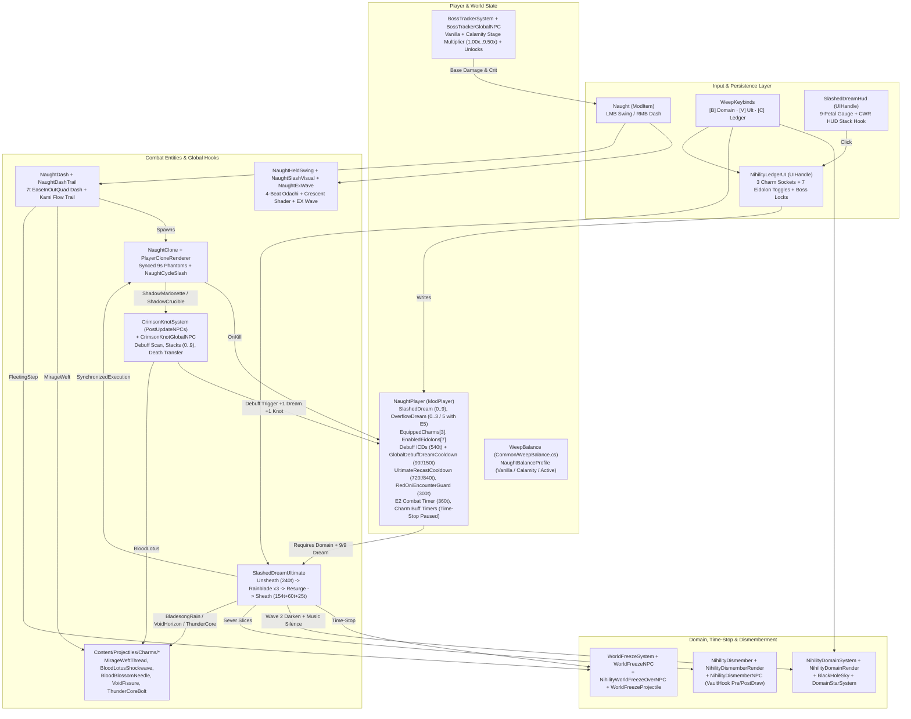
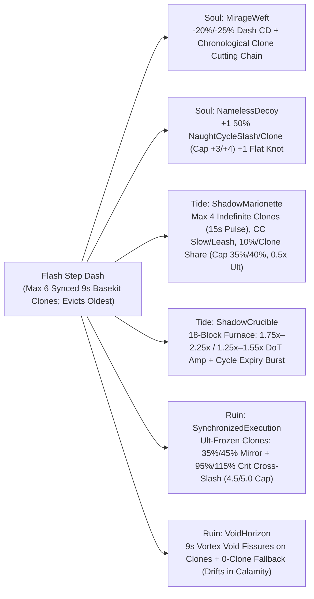

# Weep for the Departed (`Naught`) — Complete Feature, Charm, Eidolon & Architecture Reference

> **Purpose**: Single-source technical feature sheet and architectural blueprint covering the **Basekit**, **18 Nihility Charms**, **7 Reworked Eidolons (`E1–E6 + EX`)**, **Boss-Gated Progression**, **Rendering & Shader Pipelines**, and **Compatibility Hooks** in `WeepForTheDeparted`. Designed as a standalone technical reference for starting focused debugging or extension sessions on any individual subsystem.

---

## Table of Contents

1. [High-Level System Architecture & Data Flow](#1-high-level-system-architecture--data-flow)
2. [File, Projectile & Shader Registry](#2-file-projectile--shader-registry)
3. [Basekit Feature Sheet (Pre-Charm)](#3-basekit-feature-sheet-pre-charm)
   - [3.1 Weapon Foundation, Boss Scaling & Config](#31-weapon-foundation-boss-scaling--config)
   - [3.1.1 Shared Damage, Crit & Strike Helper API (Charm Migration Contract)](#311-shared-damage-crit--strike-helper-api-charm-migration-contract)
   - [3.2 4-Beat Flowing Odachi Combo](#32-4-beat-flowing-odachi-combo)
   - [3.3 Flash Step Dash](#33-flash-step-dash)
   - [3.4 Shadow Clone Lifecycle](#34-shadow-clone-lifecycle)
   - [3.5 Slashed Dream Resource & Debuff Detection](#35-slashed-dream-resource--debuff-detection)
   - [3.6 Crimson Knot Mark System](#36-crimson-knot-mark-system)
   - [3.7 Nihility Domain & Visual Pipeline](#37-nihility-domain--visual-pipeline)
   - [3.8 World Time-Freeze & Boss Dismemberment](#38-world-time-freeze--boss-dismemberment)
   - [3.9 Ultimate: Slashed Dream Cries in Red](#39-ultimate-slashed-dream-cries-in-red)
   - [3.10 HUD, Keybinds, Nihility Ledger UI & Debug Tools](#310-hud-keybinds-nihility-ledger-ui--debug-tools)
4. [Nihility Charms Feature Sheet (18 Inscriptions)](#4-nihility-charms-feature-sheet-18-inscriptions)
   - [4.1 Slot 0: Soul Inscriptions (`EquippedCharms[0]`)](#41-slot-0-soul-inscriptions-equippedcharms0)
   - [4.2 Slot 1: Tide Inscriptions (`EquippedCharms[1]`)](#42-slot-1-tide-inscriptions-equippedcharms1)
   - [4.3 Slot 2: Ruin Inscriptions (`EquippedCharms[2]`)](#43-slot-2-ruin-inscriptions-equippedcharms2)
   - [4.4 Clone Synergy Architecture Across All Three Slots](#44-clone-synergy-architecture-across-all-three-slots)
5. [Reworked Eidolons (`E1–E6 + EX`) & Boss-Gated Progression](#5-reworked-eidolons-e1e6--ex--boss-gated-progression)
   - [5.1 Reworked Eidolon Specifications (`0..6`)](#51-reworked-eidolon-specifications-06)
   - [5.2 Complete Charm & Eidolon Boss Progression Table](#52-complete-charm--eidolon-boss-progression-table)
6. [Hook-to-Feature Cross-Reference Matrix](#6-hook-to-feature-cross-reference-matrix)

---

## 1. High-Level System Architecture & Data Flow

`WeepForTheDeparted` runs on `tModLoader` (`net8.0`) with a hard dependency on **`InnoVault`** (`VaultHook`, `RenderHandle`, `UIHandle`, `NPCOverride`, `PRTLoader`) and optional runtime compatibility with **`CalamityMod`** and **`CalamityOverhaul`**.



---

## 2. File, Projectile & Shader Registry

### Core Code Files

| Layer | File | Primary Responsibility |
| :--- | :--- | :--- |
| **Mod Root & Helpers** | [WeepForTheDeparted.cs](file:///g:/GitRepos/WeepForTheDeparted/WeepForTheDeparted.cs) | `Mod` entrypoint class |
| | [WeepBalance.cs](file:///g:/GitRepos/WeepForTheDeparted/Common/WeepBalance.cs) | Immutable `NaughtBalanceProfile` & `WeepBalance` single source of truth (`Vanilla`, `Calamity`, `Active` switched by `WeepCompatibility.IsCalamityBalanceActive`) for weapon scaling, basekit combat, all 18 charms, and `E1–EX` |
| | [WeepCompatibility.cs](file:///g:/GitRepos/WeepForTheDeparted/Common/WeepCompatibility.cs) | Resolves Calamity `TrueMeleeDamageClass` / fallback, `IsCalamityBalanceActive`, cached `CalamityGlobalNPC.DR` reflection, unified `ComputeUnifiedDRPeelMultiplier` / `ApplyUnifiedDRPeel` (arbitrary `totalPeel`, `dr > 0.90f` guard, `1 + totalPeel` on 0%-DR/Vanilla), & debug debuff helper |
| | [WeepSound.cs](file:///g:/GitRepos/WeepForTheDeparted/Common/WeepSound.cs) | SoundStyle registry (`Assets/Sounds/*`, including `AcheronUltMusic` `SoundType.Music`) |
| | [WeepConfig.cs](file:///g:/GitRepos/WeepForTheDeparted/Common/Configs/WeepConfig.cs) | Server config for `OverrideWeaponScaling` (`false` default) + manual base/per-boss sliders, Calamity/universal boss toggles, unified `BalanceMode` (`Auto`/`Calamity`/`Vanilla`), & `UnlockAllInscriptionsAndEidolons` sandbox bypass |
| **Weapon & Player** | [Naught.cs](file:///g:/GitRepos/WeepForTheDeparted/Content/Items/Weapons/Naught.cs) | Weapon item, LMB/RMB routing, `GetEffectiveBaseDamage()`/`GetEffectiveBonusCrit()` scaling hooks (preserving prefix scale), dynamic profile/stage tooltip, world scabbard draw, recipe |
| | [NaughtPlayer.cs](file:///g:/GitRepos/WeepForTheDeparted/Common/Players/NaughtPlayer.cs) | Resource gauges (`CurrentMaxOverflowDream`), `GlobalDebuffDreamCooldown`, `UltimateRecastCooldown`, `StartUltimateRecastCooldown`, `CanTriggerRedOniBossEncounter` / `MarkRedOniBossEncounterTriggered`, world-gated charm getters, 7-node Eidolon toggles (`EnabledEidolons[7]`), `IsTrueUltimateStrike` / `IsE6InheritedUltimateStrike` / `GetKarmaSeverEffectiveness` / `StrikeNPC(..., isUltimate)`, Ult critically-damped camera tracking & `UltCameraSystem` dynamic zoom + fail-safe player draw hiding, `E2` combat timer, Time-Stop-paused cooldowns & buff timers, save/load |
| | [BossTrackerSystem.cs](file:///g:/GitRepos/WeepForTheDeparted/Common/Systems/BossTrackerSystem.cs) | Unique boss defeat aggregation, cached Calamity `DownedBossSystem` reflection for `GetCalamityPostMLStageMultiplier()` (`1.00f..9.50f`), `GetEffectiveBaseDamage()`, `GetEffectiveBonusCrit()`, `DefeatedPostMoonLordBoss` sync, centralized `IsCharmUnlocked` / `IsEidolonUnlocked` registries & hints, progression labels |
| | [BossTrackerGlobalNPC.cs](file:///g:/GitRepos/WeepForTheDeparted/Common/GlobalNPCs/BossTrackerGlobalNPC.cs) | Records killed bosses & Post-Moon Lord modded kills into `BossTrackerSystem` |
| **Basekit Combat** | [NaughtHeldSwing.cs](file:///g:/GitRepos/WeepForTheDeparted/Content/Projectiles/NaughtHeldSwing.cs) | 4-beat odachi swing controller (`WeepBalance.Active.ComboBaseReachPx[ComboStep]`, `E3`/`EX` reach scale, `EX` wave spawn with shared per-beat `hitNPCs`), dash-cancel, virtual charm hooks |
| | [NaughtSlashVisual.cs](file:///g:/GitRepos/WeepForTheDeparted/Content/Projectiles/NaughtSlashVisual.cs) | Polar crescent slash shader visual + swept polyline hitbox |
| | [NaughtExWave.cs](file:///g:/GitRepos/WeepForTheDeparted/Content/Projectiles/NaughtExWave.cs) | `EX` projected crimson spatial wave (`WeepBalance.Active.ExWaveDamageMult` = `0.40x` Vanilla / `0.50x` Calamity `TrueMelee`, `SlashShader`, shared `SharedBeatHits` zero double-hit dedup) |
| | [NaughtDash.cs](file:///g:/GitRepos/WeepForTheDeparted/Content/Projectiles/NaughtDash.cs) | Flash Step movement (`DashMinDistPx..DashMaxDistPx`, `DashLingerIFrames`, `DashCooldownTicks`), `BasekitMaxClones` (`6`) eviction, clone spawn/sync, dash charm triggers |
| | [NaughtDashTrail.cs](file:///g:/GitRepos/WeepForTheDeparted/Content/Projectiles/NaughtDashTrail.cs) | Flowing spatial ribbon rendered with `OniKamuiFlow` |
| | [NaughtClone.cs](file:///g:/GitRepos/WeepForTheDeparted/Content/Projectiles/NaughtClone.cs) | 9s decoy clone AI, synced expiry counter, cycle completion trigger, clone charm behaviors (`SyncMirrorRainbladeMult` / `SyncCrossSlashMult` with `isUltimate: true`) |
| | [NaughtCycleSlash.cs](file:///g:/GitRepos/WeepForTheDeparted/Content/Projectiles/NaughtCycleSlash.cs) | Localized target-anchored Onikiri-style orbital slash (`SlashShader`) + `NaughtPlayer.StrikeNPC(..., isUltimate: false)` (so E6 routes via `IsE6InheritedUltimateStrike`) |
| | [SlashedDreamUltimate.cs](file:///g:/GitRepos/WeepForTheDeparted/Content/Projectiles/SlashedDreamUltimate.cs) | Full Ultimate state machine & 3D choreography controller (`WeepBalance.Active` Rainblades/Resurge/Siphon/Emancipator/ThunderCore/VoidHorizon fallback flag + `StartUltimateRecastCooldown` on `OnKill`) |
| **Knots & Debuffs** | [CrimsonKnotGlobalNPC.cs](file:///g:/GitRepos/WeepForTheDeparted/Common/GlobalNPCs/CrimsonKnotGlobalNPC.cs) | Per-NPC knot stack pool, debuff scanner, death transfer, Marionette damage echo |
| | [CrimsonKnotSystem.cs](file:///g:/GitRepos/WeepForTheDeparted/Common/Systems/CrimsonKnotSystem.cs) | `PostUpdateNPCs` driver guaranteeing debuff scans run past CWR `NPCOverride` |
| | [CrimsonKnotRenderHandle.cs](file:///g:/GitRepos/WeepForTheDeparted/Common/Visuals/CrimsonKnotRenderHandle.cs) | `RenderHandle` (`DrawBeforeInfernoRings`) drawing knots above overridden bosses |
| | [CrimsonKnotTransferBeam.cs](file:///g:/GitRepos/WeepForTheDeparted/Content/Projectiles/CrimsonKnotTransferBeam.cs) | Additive 3-layer lightning beam for knot/clone transfer visuals |
| **Domain, Freeze, Dismember** | [NihilityDomainSystem.cs](file:///g:/GitRepos/WeepForTheDeparted/Common/Visuals/NihilityDomainSystem.cs) | Domain state, Wave 1 & Wave 2 progression, `EndCapture` hook, sunlight dim |
| | [NihilityDomainRender.cs](file:///g:/GitRepos/WeepForTheDeparted/Common/Visuals/NihilityDomainRender.cs) | `RenderHandle` drawing Black Hole Sky in sky, before-tiles, and ult terrain-darken |
| | [BlackHoleSky.cs](file:///g:/GitRepos/WeepForTheDeparted/Common/Visuals/BlackHoleSky.cs) | `CustomSky` registration and cloud suppression |
| | [DomainStarSystem.cs](file:///g:/GitRepos/WeepForTheDeparted/Common/Visuals/DomainStarSystem.cs) | 130 persistent stars (55 Keplerian orbital + 75 stream-drifting) + reflections |
| | [Ult3DProjection.cs](file:///g:/GitRepos/WeepForTheDeparted/Common/Visuals/Ult3DProjection.cs) | 2.5D `(F, U, Z)` combat-local projection (`FocalLength = 420f`), safe viewport origin, easing & 3D VFX structs |
| | [Ult3DRenderHandle.cs](file:///g:/GitRepos/WeepForTheDeparted/Common/Visuals/Ult3DRenderHandle.cs) | `RenderHandle` bracketing Terraria's native player pass: `DrawBeforePlayers` (water ripples, far `-Z` `SlashShader` ribbons, 3D `PlayerCloneRenderer` afterimages, far 3D blade) & `DrawAfterPlayers` (front 3D blade/sheath, near `+Z` ribbons, cleaved reality seams, crimson framing vignette, gleams) |
| | [NaughtSheathLayer.cs](file:///g:/GitRepos/WeepForTheDeparted/Common/Visuals/NaughtSheathLayer.cs) | `PlayerDrawLayer` drawing scabbard on idle player's hip |
| | [PlayerCloneRenderer.cs](file:///g:/GitRepos/WeepForTheDeparted/Common/Visuals/PlayerCloneRenderer.cs) | Offscreen dummy `Player` visual duplication + violet phantom tinting |
| | [WorldFreezeSystem.cs](file:///g:/GitRepos/WeepForTheDeparted/Common/Systems/WorldFreezeSystem.cs) | Reference-counted time-stop, `VaultHook` on liquids/hotbar, projectile exemption |
| | [WorldFreezeNPC.cs](file:///g:/GitRepos/WeepForTheDeparted/Common/GlobalNPCs/WorldFreezeNPC.cs) | Saves/restores NPC transform & freezes timers during active time-stop |
| | [NihilityWorldFreezeOverNPC.cs](file:///g:/GitRepos/WeepForTheDeparted/Common/GlobalNPCs/NihilityWorldFreezeOverNPC.cs) | Universal InnoVault `NPCOverride` (`TargetID = -1`) halting CWR Brutal boss AI |
| | [WorldFreezeProjectile.cs](file:///g:/GitRepos/WeepForTheDeparted/Common/GlobalProjectiles/WorldFreezeProjectile.cs) | Freezes non-exempt projectiles during active time-stop |
| | [FleetingStepProjectile.cs](file:///g:/GitRepos/WeepForTheDeparted/Common/GlobalProjectiles/FleetingStepProjectile.cs) | Global 50% hostile projectile time-dilation (half-rate AI + smooth `0.5x` velocity) for `FleetingStep` (`150`t / `2.50s` window) |
| | [NihilityDismember.cs](file:///g:/GitRepos/WeepForTheDeparted/Common/Visuals/Dismember/NihilityDismember.cs) | Convex polygon half-plane clipper, separation curves, group worm collection |
| | [NihilityDismemberRender.cs](file:///g:/GitRepos/WeepForTheDeparted/Common/Visuals/Dismember/NihilityDismemberRender.cs) | `RenderTarget2D` snapshot capturer in `DrawNPCsOverTiles` |
| | [NihilityDismemberNPC.cs](file:///g:/GitRepos/WeepForTheDeparted/Common/Visuals/Dismember/NihilityDismemberNPC.cs) | `VaultHook` overriding `NPCLoader.PreDraw`/`PostDraw` + `OniDismember` triangle strip draw |
| **UI, Particles & Debug** | [WeepKeybinds.cs](file:///g:/GitRepos/WeepForTheDeparted/Common/Systems/WeepKeybinds.cs) | `[V]` Ultimate, `[B]` Domain, `[C]` Ledger keybind registrations |
| | [SlashedDreamHud.cs](file:///g:/GitRepos/WeepForTheDeparted/Common/UI/SlashedDreamHud.cs) | 9-petal flower HUD, `UltimateRecastCooldown` dimmed state + centered `0.0s` timer, dynamic `EmancipatorCritBonus` display, click-to-open Ledger |
| | [SlashedDreamHudSystem.cs](file:///g:/GitRepos/WeepForTheDeparted/Common/UI/SlashedDreamHudSystem.cs) | Logic update tick & non-InnoVault interface fallback layer |
| | [CalamityOverhaulHudIntegration.cs](file:///g:/GitRepos/WeepForTheDeparted/Common/UI/CalamityOverhaulHudIntegration.cs) | MonoMod hook shifting `BottomLeftHudStack.ResolveAnchor` up by `145 * Appear` |
| | [NihilityLedgerUI.cs](file:///g:/GitRepos/WeepForTheDeparted/Common/UI/NihilityLedger/NihilityLedgerUI.cs) | Full-screen Charm & Eidolon registry, live `WeepBalance.Active` description formatting (`GetCharmDescription`, `GetEidolonDescription`), `[CALAMITY PROFILE]`/`[VANILLA PROFILE]` header badge, layout, input, tooltips |
| | [NihilityLedgerSystem.cs](file:///g:/GitRepos/WeepForTheDeparted/Common/UI/NihilityLedger/NihilityLedgerSystem.cs) | `PostUpdateInput`, `UpdateUI`, SP pause, input blocker (`Interface Logic 1`) & fallback draw layer |
| | [NihilityLedgerTheme.cs](file:///g:/GitRepos/WeepForTheDeparted/Common/UI/NihilityLedger/NihilityLedgerTheme.cs) | Palette constants & vector primitive draw helpers (`DrawGlowLine`, `DrawCircle`, etc.) |
| | [NihilityDebugItem.cs](file:///g:/GitRepos/WeepForTheDeparted/Content/Items/Debug/NihilityDebugItem.cs) | QA item/accessory applying 8+ vanilla & Calamity debuffs per True Melee/Melee hit |
| | [NihilityDebugPlayer.cs](file:///g:/GitRepos/WeepForTheDeparted/Common/Players/NihilityDebugPlayer.cs) | `DebuffInflictionActive` accessory effect hook |
| | [AbyssGripDebuff.cs](file:///g:/GitRepos/WeepForTheDeparted/Content/Buffs/AbyssGripDebuff.cs) | `Main.debuff` (`pvpBuff`, `buffNoSave`) inflicted on Naught hits by `AbyssGrip` |
| | [RainleafCooldownBuff.cs](file:///g:/GitRepos/WeepForTheDeparted/Content/Buffs/RainleafCooldownBuff.cs) | Non-removable cooldown debuff icon synced to `VoidPhasingCooldown` (`120.0s` Vanilla / `105.0s` Calamity, paused during Time-Stop) |
| | [StillWaterFocusBuff.cs](file:///g:/GitRepos/WeepForTheDeparted/Content/Buffs/StillWaterFocusBuff.cs) | Positive focus buff icon displayed while `IsStillWaterActive` is true (`ModifyBuffText` reads `WeepBalance.Active`) |
| | [WitheredRiverDebuff.cs](file:///g:/GitRepos/WeepForTheDeparted/Content/Buffs/WitheredRiverDebuff.cs) | `Main.debuff` DR-peel debuff applied by `WitheredRiver` on Naught hits (`14%` Vanilla / `10%` Calamity) |
| | [ShadowCrucibleDebuff.cs](file:///g:/GitRepos/WeepForTheDeparted/Content/Buffs/ShadowCrucibleDebuff.cs) | `Main.debuff` furnace brand applied inside `ShadowCrucible` clone zones, storing amplified DoT pressure until cycle expiry |
| | [SiphonHasteBuff.cs](file:///g:/GitRepos/WeepForTheDeparted/Content/Buffs/SiphonHasteBuff.cs) | Post-Ultimate `+15%` movement speed & acceleration buff synced with `SiphonMoveSpeedTimer` (`8.0s`) for `DepartedSiphon` |
| | [EmancipatorWillBuff.cs](file:///g:/GitRepos/WeepForTheDeparted/Content/Buffs/EmancipatorWillBuff.cs) | Post-Ultimate True Melee Crit Chance buff (`ModifyBuffText` reads `WeepBalance.Active.EmancipatorCritBonus`: `+15%` Vanilla / `+20%` Calamity) synced with `EmancipatorCritBuffTimer` (`10.0s`) for `EmancipatorWill` |
| | [Content/Visuals/Particles/](file:///g:/GitRepos/WeepForTheDeparted/Content/Visuals/Particles/) | Pooled `BasePRT` classes: `VoidSparkPRT`, `CrimsonPetalPRT`, `DimensionalExplosionPRT`, `CrimsonBloomPRT` |

### Charm Sub-Projectiles (`Content/Projectiles/Charms/`)

| Class | Parent Charm | Lifespan | Collision / Effect |
| :--- | :--- | :--- | :--- |
| [MirageWeftThread.cs](file:///g:/GitRepos/WeepForTheDeparted/Content/Projectiles/Charms/MirageWeftThread.cs) | `MirageWeft` | Persistent while clones active | Native `Colliding` along chronological chain (`Clone 1 -> ... -> Latest -> Player`, `16f` width); `MirageWeftDamageMult` (`0.25x` Vanilla / `0.35x` Calamity) scaled True Melee dmg, `MirageWeftHitCooldownTicks` (`60`t / `51`t) local immunity, `WorldFreezeSystem` `CanDamage=false`, snapshot debuff isolation (`ProcessMirageWeftDebuff`) & `ShadowMarionette` |
| [BloodLotusShockwave.cs](file:///g:/GitRepos/WeepForTheDeparted/Content/Projectiles/Charms/BloodLotusShockwave.cs) | `BloodLotus` | `35` ticks (`WorldFreezeSystem` exempt) | Locked `anchorCenter` + radial `Colliding` (`10f` -> `BloodLotusMaxRadiusPx` `184f`/`208f` `sqrt` easing); `(BloodLotusBaseMult + BloodLotusKnotMult * Knots)x` (`0.85+0.10*k` Vanilla / `1.00+0.12*k` Calamity) `GetNaughtDamage` True Melee; shared global per-player/per-NPC `lastGlobalHitTick` (`BloodLotusGlobalHitCooldownTicks = 24`t); `BloodLotusShader` + `BloodLotusBloom.png` + PRT burst |
| [BloodBlossomNeedle.cs](file:///g:/GitRepos/WeepForTheDeparted/Content/Projectiles/Charms/BloodBlossomNeedle.cs) | `BladesongRain` | `BladesongFlightUpdates` (`180` updates / `1.50s`, `extraUpdates = 1`) | Infinite crowd pierce (`penetrate = -1`, `BladesongHitCooldownUpdates = 42` updates / `0.35s` cd), capped at `BladesongMaxHitsPerNpc = 2` hits per enemy via `perNpcHits`, `BladesongNeedleMult` (`0.45x` / `0.55x`), `30-41` update outward blossom arc, prioritizes non-origin enemies within `1400f` px, `AngleTowards` steering (`18f` cruise), `36`-needle cap, `BloodBlossomNeedleShader` ribbon |
| [VoidFissure.cs](file:///g:/GitRepos/WeepForTheDeparted/Content/Projectiles/Charms/VoidFissure.cs) | `VoidHorizon` | `540` ticks (9.0s, `WorldFreezeSystem` paused) | Circular/elliptical portal on active `NaughtClone`s (or `ai[0] >= 0.5f` 0-clone fallback drifting at `VoidHorizonFallbackDriftSpeed` `0f`/`0.80f` px/t toward nearest boss when unfrozen); `220f` px non-boss vortex pull + `35%` slow; `VoidHorizonDamageMult` (`0.45x` / `0.60x`) `StrikeNPC` True Melee every `24`t (`VoidHorizonRadiusPx = 120f` / `136f`, shared per-NPC cooldown) + `BuffID.Slow` (`120`t); `VoidHorizonShader` |
| [ThunderCoreBolt.cs](file:///g:/GitRepos/WeepForTheDeparted/Content/Projectiles/Charms/ThunderCoreBolt.cs) | `ThunderCore` | `28` ticks | Sequentially dispatched (`18`t / `0.3s` stagger) post-freeze; strikes within `110f` px via `NaughtPlayer.StrikeNPC` (`GetNaughtDamage(WeepBalance.Active.ThunderCoreBoltMult)` `0.45x`/`0.60x` guaranteed crit, `WeepCompatibility.TrueMelee`) + `BuffID.Electrified` (`180`t, barrage-capped at `+1` Dream / `+1` Knot); `ThunderCoreShader` |

### Shader Registry ([ShaderLoader.cs](file:///g:/GitRepos/WeepForTheDeparted/Content/Shaders/ShaderLoader.cs))

| Property | Compiled Shader | Status & Consumer |
| :--- | :--- | :--- |
| `SlashShader` | `OniCrimsonSlash.fxc` | **Active** — `NaughtSlashVisual`, `NaughtCycleSlash`, `Ult3DRenderHandle.DrawSlashRibbonsSplit` / `DrawCleavedSeams` (`uMode=1` 3D `TriangleList` ribbons & seams) |
| `FlowShader` | `OniKamuiFlow.fxc` | **Active** — `NaughtDashTrail` |
| `BlackHoleSkyShader` | `BlackHoleSky.fxc` | **Active** — `NihilityDomainRender` (Sky, BeforeTiles, DrawNPCsOverTiles) |
| `NihilityDomainShader` | `NihilityDomain.fxc` | **Active** — `NihilityDomainSystem` (`ScreenShaderData`, `VeryHigh` priority) |
| `DismemberShader` | `OniDismember.fxc` | **Active** — `NihilityDismemberNPC` severed polygon seam glow |
| `CrimsonKnotShader` | `CrimsonKnot.fxc` | **Active** — `CrimsonKnotGlobalNPC.DrawKnotDirect`, `BloodLotusShockwave.DrawHighResLotusBloom` |
| `FlowerBloomShader` | `FlowerBloom.fxc` | **Active** — `CrimsonBloomPRT.PreDraw` (`TriggerMilestoneFeedback`, `BloodLotusShockwave`), `BloodLotusShockwave.DrawHighResLotusBloom` rim highlight |
| `BloodLotusShader` | `BloodLotusShockwave.fxc` | **Active** — `BloodLotusShockwave.DrawProceduralShockwaveQuad` (anti-aliased mandala & exact-radius shockwave ring) |
| `BloodBlossomNeedleShader` | `BloodBlossomNeedle.fxc` | **Active** — `BloodBlossomNeedle.DrawShaderRibbon` (tapered energy core, noise-scrolled plasma/petal trail, crisp additive edge) |
| `VoidHorizonShader` | `VoidHorizonPortal.fxc` | **Active** — `VoidFissure.DrawPortalShaderQuad` (polar swirl UV distortion, dark event-horizon core, jagged crimson/violet rim) |
| `SyncCrossSlashShader` | `OniSyncCrossSlash.fxc` | **Active** — `NaughtClone.DrawSyncCrossSlashShaderEffects` (`uMode=0` convergent cross-slash beam, `uMode=1` clone afterimage trail, `uMode=2` crimson rupture flash) |
| `ThunderCoreShader` | `ThunderCoreLightning.fxc` | **Active** — `ThunderCoreBolt.DrawShaderLightning` (`BoltTech` jagged branching lightning + `ScorchTech` impact scorch flash) |
| `WitheredRiverShader` | `WitheredRiver.fxc` | **Active** — `CrimsonKnotGlobalNPC.PreDraw` (`TechWitherBody` withered body distortion) |
| `UltQuadShader` | `UltQuad.fxc` | **Active** — `Ult3DRenderHandle` (branchless 3-technique FX binding single `uQuadTex`: `QuadLinearTech` 3D `NaughtUltBlade` & blade ghosts with `uSilhouetteStrength`, `RippleTech` additive water ripple strips, `VignetteTech` clip-space crimson framing vignette) |
| `WorldGradeShader`, `FinaleWoundShader`, `FinaleBladeShader`, `SheathFlashShader` | `OniWorldGrade.fxc`, `OniFinaleWound.fxc`, `OniFinaleBlade.fxc`, `SheathFlash.fxc` | **Loaded only** — properties exist in `ShaderLoader`, currently unused (`DrawScabbardFlash` uses vanilla textures) |

---

## 3. Basekit Feature Sheet (Pre-Charm)

This section documents Naught's complete behavior when **no charms or eidolons are modifying gameplay**.

### 3.1 Weapon Foundation, Boss Scaling & Config

* **Design & Role**: Progression-adaptive True Melee odachi crafted early (`10` Iron/Lead Bar + `5` Fallen Star + `15` Wood @ Anvil in [Naught.cs#L196-L204](file:///g:/GitRepos/WeepForTheDeparted/Content/Items/Weapons/Naught.cs#L196-L204)) that scales flat base damage and crit alongside world boss kills (and Calamity progression stage multipliers) so it stays relevant from Pre-Boss through Post-Moon Lord / Calamity endgame.
* **Implementation**:
  * **Dual-Mode Balance Profile (`Common/WeepBalance.cs`)**: Defines immutable `NaughtBalanceProfile` with static `Vanilla`, `Calamity`, and `Active` (`WeepCompatibility.IsCalamityBalanceActive ? Calamity : Vanilla`) instances serving as the single source of truth for weapon scaling, basekit combat, all 18 charms, and `E1–EX`.
  * **Item stats** ([Naught.cs#L20-L43](file:///g:/GitRepos/WeepForTheDeparted/Content/Items/Weapons/Naught.cs#L20-L43)): `Item.damage` initializes from `WeepBalance.Active.BaseSwordDamage` (`14` Vanilla / `16` Calamity), or `WeepConfig.BaseSwordDamage` (default `25`) when `WeepConfig.OverrideWeaponScaling = true`. `DamageType = WeepCompatibility.TrueMelee` (resolves Calamity's `TrueMeleeDamageClass` if installed, else `DamageClass.Melee`, [WeepCompatibility.cs#L51-L58](file:///g:/GitRepos/WeepForTheDeparted/Common/WeepCompatibility.cs#L51-L58)), `useTime = 16`, `useAnimation = 16`, `knockBack = 5.5f`, `channel = true`, `autoReuse = true`, `noMelee = true`, `noUseGraphic = true`.
  * **Input routing** ([Naught.cs#L47-L76](file:///g:/GitRepos/WeepForTheDeparted/Content/Items/Weapons/Naught.cs#L47-L76)): Completely locked out while `SlashedDreamUltimate` is active. Right-click (`altFunctionUse == 2`) fires `NaughtDash` if `NaughtPlayer.DashCooldown <= 0` and no dash is active. Left-click fires `NaughtHeldSwing`.
  * **Boss progression math & Stage Multipliers** ([Naught.cs#L114-L135](file:///g:/GitRepos/WeepForTheDeparted/Content/Items/Weapons/Naught.cs#L114-L135), [BossTrackerSystem.cs#L287-L396](file:///g:/GitRepos/WeepForTheDeparted/Common/Systems/BossTrackerSystem.cs#L287-L396)):
    * `BossTrackerSystem.GetEffectiveBaseDamage()`: Computes `profile.BaseSwordDamage + BossCount * profile.DamagePerBoss` (`14 + 4.0 * BossCount` Vanilla; `16 + 3.0 * BossCount` Calamity), multiplied by `GetCalamityPostMLStageMultiplier()` when `profile.UseCalamityStageMultiplier` is true (`Calamity` mode). When `WeepConfig.OverrideWeaponScaling == true`, falls back to manual `cfg.BaseSwordDamage + BossCount * cfg.DamagePerBoss` without stage multipliers. `Naught.ModifyWeaponDamage` applies `effectiveBase - Item.damage` and preserves item `prefixScale` (`Item.damage / sampleDamage`) plus armor/accessory multiplicative scaling.
    * `BossTrackerSystem.GetEffectiveBonusCrit()`: Returns `BossCount * profile.CritPerBoss` (`+0.3%` Vanilla / `+0.2%` Calamity), or `BossCount * cfg.CritPerBoss` (`+0.4%` default) when `OverrideWeaponScaling == true`.
    * `BossTrackerSystem.GetCalamityPostMLStageMultiplier()`: Uses cached `CalamityMod.DownedBossSystem` reflection (cleared in `Unload()`, safe no-op returning Vanilla tiers / `1.00f` pre-HM when CalamityMod is absent): `1.00f` (Pre-HM), `1.05f` (`Main.hardMode`), `1.15f` (`NPC.downedGolemBoss`), `1.35f` (`NPC.downedMoonlord`), `2.00f` (`downedProvidence`), `3.20f` (`downedPolterghast`), `4.50f` (`downedDoG`), `6.20f` (`downedYharon`), `9.50f` (`downedExoMechs || downedCalamitas`).
    * `BossCount` deduplicates Vanilla boss/event downed flags ([BossTrackerSystem.cs#L441-L478](file:///g:/GitRepos/WeepForTheDeparted/Common/Systems/BossTrackerSystem.cs#L441-L478)), reflected Calamity `DownedBossSystem.downed*` flags when `IncludeCalamityBosses = true` ([L480-L508](file:///g:/GitRepos/WeepForTheDeparted/Common/Systems/BossTrackerSystem.cs#L480-L508)), and `BossTrackerGlobalNPC.OnKill` tracked keys when `UniversalBossScaling = true` ([BossTrackerGlobalNPC.cs#L10-L22](file:///g:/GitRepos/WeepForTheDeparted/Common/GlobalNPCs/BossTrackerGlobalNPC.cs#L10-L22)).
  * **Idle/World presentation**: On the ground (`PreDrawInWorld`, [Naught.cs#L86-L112](file:///g:/GitRepos/WeepForTheDeparted/Content/Items/Weapons/Naught.cs#L86-L112)), `NaughtSheath` stands upright on its kojiri tip. When held idle (`NaughtSheathLayer` [NaughtSheathLayer.cs#L13-L85](file:///g:/GitRepos/WeepForTheDeparted/Common/Visuals/NaughtSheathLayer.cs#L13-L85) + `NaughtPlayer.ModifyDrawInfo`), the scabbard rests at `191.5°` on the hip with the player's front arm lowered onto the hilt.

---

### 3.1.1 Shared Damage, Crit & Strike Helper API (Charm Migration Contract)

All Naught abilities and future charm reworks should plug into the centralized damage, crit, and strike pipeline on [NaughtPlayer.cs](file:///g:/GitRepos/WeepForTheDeparted/Common/Players/NaughtPlayer.cs) and [WeepCompatibility.cs](file:///g:/GitRepos/WeepForTheDeparted/Common/WeepCompatibility.cs) instead of reading raw `HeldItem.damage` or calling `NPC.SimpleStrikeNPC(..., DamageClass.Melee)` directly:

* **Damage Class Filter**: `WeepCompatibility.IsNaughtDamageClass(DamageClass)` ([WeepCompatibility.cs#L175-L182](file:///g:/GitRepos/WeepForTheDeparted/Common/WeepCompatibility.cs#L175-L182)) matches `TrueMelee`, `TrueMeleeNoSpeed`, `DamageClass.Melee`, and `DamageClass.MeleeNoSpeed`; `IsTrueMeleeDamageClass` ([L189-L205](file:///g:/GitRepos/WeepForTheDeparted/Common/WeepCompatibility.cs#L189-L205)) matches or `CountsAsClass` Calamity `TrueMelee*` (if loaded) else `Melee`/`MeleeNoSpeed`.
* **Item & Stat Resolution** ([NaughtPlayer.cs#L395-L491](file:///g:/GitRepos/WeepForTheDeparted/Common/Players/NaughtPlayer.cs#L395-L491)):
  * `ResolveNaughtItem()`: Checks `HeldItem` → `Main.mouseItem` → `Player.inventory` → `lastKnownNaughtItem` → lazily-initialized `Naught` fallback item (`WeepConfig.BaseSwordDamage`-synced). Preserves item prefixes/reforges and boss scaling even if the player briefly swaps off `Naught` while clones or projectiles linger.
  * `GetNaughtDamage(float mult = 1f)`: Resolves `Player.GetWeaponDamage(ResolveNaughtItem())` (including `Naught.ModifyWeaponDamage` boss scaling, True Melee/Melee gear & buffs, and `NaughtPlayer.ModifyWeaponDamage`) and returns `Math.Max(1, (int)MathF.Round(baseScaled * mult))`.
  * `GetNaughtCritChance()` / `RollNaughtCrit(float bonusCritChance = 0f)`: Resolves `Player.GetWeaponCrit(ResolveNaughtItem())` (item base + boss scaling + player crit + `NaughtPlayer.ModifyWeaponCrit`) and rolls standard `Main.rand.Next(100) < totalCrit`. Note: `NaughtPlayer.ModifyWeaponDamage` and `ModifyWeaponCrit` ([NaughtPlayer.cs#L1852-L1877](file:///g:/GitRepos/WeepForTheDeparted/Common/Players/NaughtPlayer.cs#L1852-L1877)) gate on `item.type == ModContent.ItemType<Naught>()` without requiring `IsNaughtEquipped`, so lingering-entity queries and inventory tooltips remain accurate during brief weapon swaps.
* **Central Hit-Modifier Choke Point**: `ApplyNaughtHitModifiers(NPC target, ref NPC.HitModifiers modifiers, DamageClass damageType, Projectile sourceProj = null, int baseCritChanceForNative = 0)` in [NaughtPlayer.cs#L2104-L2178](file:///g:/GitRepos/WeepForTheDeparted/Common/Players/NaughtPlayer.cs#L2104-L2178) applies:
  * `StillWater` (`modifiers.CritDamage += profile.StillWaterCritDamage`: `+0.15f` Vanilla / `+0.18f` Calamity).
  * `E4` (`modifiers.FinalDamage *= 1.08f` inside `NihilityDomainSystem.IsPositionInsideDomain(target.Center)` on both `IsTrueUltimateStrike` and `IsE6InheritedUltimateStrike`).
  * `KarmaSever`: `modifiers.ScalingArmorPenetration += profile.KarmaSeverUltDefPen` (`0.35f` Vanilla / `0.40f` Calamity) on `IsTrueUltimateStrike` hits ONLY, plus Boss DR peel (`profile.KarmaSeverBossDrPeel * GetKarmaSeverEffectiveness(sourceProj)`) coordinated in a single pass with `CrimsonKnotGlobalNPC.ConsumePendingWitheredDrPeel()` via `WeepCompatibility.ComputeUnifiedDRPeelMultiplier` / `ApplyUnifiedDRPeel` (`0.15f` Vanilla / `0.12f` Calamity on true Ult; `50%` via `KarmaSeverE6Scale = 0.50f` on E6-inherited strikes).
  * `E1` (`+profile.E1CritBonus` `+6%` Vanilla / `+8%` Calamity crit chance on native colliding hits against debuffed enemies).
  * `CrimsonKnotGlobalNPC.ModifyIncomingHit` evaluates `WitheredRiver` DR peel (`profile.WitheredRiverDrPeel`: `0.14f` Vanilla / `0.10f` Calamity via `WeepCompatibility.ApplyUnifiedDRPeel`, recording `pendingWitheredDrPeel` so `KarmaSever` applies the exact single-pass incremental ratio without double-multiplying) and `AbyssGrip` (`FinalDamage`).
* **`IsTrueUltimateStrike` / `IsE6InheritedUltimateStrike` / `GetKarmaSeverEffectiveness` Contract** ([NaughtPlayer.cs#L2046-L2098](file:///g:/GitRepos/WeepForTheDeparted/Common/Players/NaughtPlayer.cs#L2046-L2098)):
  * `IsTrueUltimateStrike(Projectile)`: Returns `true` ONLY for `SlashedDreamUltimate`, `ThunderCoreBolt`, `BloodBlossomNeedle`, `VoidFissure`, or `NaughtClone` when `activeStrikeIsUltimate` (`isUltimate: true` passed by `PerformMirrorRainblade` / `PerformSheathingCrossSlash`).
  * `IsE6InheritedUltimateStrike(Projectile)`: Returns `true` when `HasEidolon6` is active for `NaughtHeldSwing`, `NaughtSlashVisual`, `NaughtCycleSlash` (`isUltimate: false`), and `NaughtExWave`.
  * `GetKarmaSeverEffectiveness(Projectile)`: Returns `1.0f` for `IsTrueUltimateStrike`, `WeepBalance.Active.KarmaSeverE6Scale` (`0.50f`) for `IsE6InheritedUltimateStrike`, and `0f` otherwise.
  * `StrikeNPC` captures `bool isTrueUltForShare = IsTrueUltimateStrike(sourceProj)` before resetting `activeStrikeIsUltimate` and passes it to `RunMarionetteDamageShare(..., isTrueUltForShare)` so `ShadowMarionette` echoed shares never inherit Ultimate status and only halve share damage (`MarionetteUltShareScale = 0.50f`) on true Ultimate strikes.
* **Unified Strike Helper (`StrikeNPC`)** ([NaughtPlayer.cs#L2186-L2346](file:///g:/GitRepos/WeepForTheDeparted/Common/Players/NaughtPlayer.cs#L2186-L2346)):
  ```csharp
  public int StrikeNPC(
      NPC target, int damage, int hitDirection = 0, bool? crit = null,
      float knockBack = 0f, DamageClass damageType = null, bool damageVariation = false,
      bool applyHitModifiers = true, bool allowDamageShare = true,
      Projectile sourceProj = null, HitModifierCallback modifyHit = null,
      bool noPlayerInteraction = false, bool isUltimate = false)
  ```
  * Defaults `damageType` to `sourceProj?.DamageType ?? WeepCompatibility.TrueMelee`.
  * Runs `target.GetIncomingStrikeModifiers`, adds `Player.GetTotalArmorPenetration(damageType)` (+ `sourceProj.ArmorPenetration`), then:
    * When `sourceProj != null`: syncs `sourceProj.CritChance` if unset (`<= 0`), temporarily adds `(int)MathF.Round(WeepBalance.Active.E1CritBonus)` (`+6` Vanilla / `+8` Calamity) to `sourceProj.CritChance` in `try/finally` when `E1` applies so overcrit mods see the boosted rate, and invokes `CombinedHooks.ModifyHitNPCWithProj(sourceProj, target, ref modifiers)` (which runs `NaughtPlayer.ModifyHitNPCWithProj` → `ApplyNaughtHitModifiers` once, unless suppressed via `applyHitModifiers: false`).
    * When `sourceProj == null`: invokes `PlayerLoader.ModifyHitNPCWithItem(Player, ResolveNaughtItem(), target, ref modifiers)` (which runs `NaughtPlayer.ModifyHitNPCWithItem` → `ApplyNaughtHitModifiers` once, unless suppressed via `applyHitModifiers: false`).
  * **Crit & `ImprovedCrits` / Overcrit Compatibility**: Rolls `crit ?? (damageType.UseStandardCritCalcs && Main.rand.Next(100) < critChance)` (setting `modifiers.SetCrit()` if `crit == true`), applies `modifyHit?.Invoke(ref modifiers)`, calls `modifiers.ToHitInfo(...)` → `target.StrikeNPC(hit)` → `NetMessage.SendStrikeNPC(target, in hit)`, triggers `MarkE2CombatActivity` & `TryApplyTideHitDebuffs` (when `damageDone > 0 && applyHitModifiers && IsNaughtDamageClass`), invokes `PlayerLoader.OnHitNPC(Player, target, in hit, damageDone)`, and runs `RunMarionetteDamageShare(target, damageDone, isTrueUltForShare)` (`allowDamageShare && !isPropagatingMarionette && HasShadowMarionette`). This guarantees multi-tier crit mods like `ImprovedCrits` hook both `ModifyHitNPCWithProj`/`ModifyHitNPCWithItem` (reading `proj.CritChance` / `GetWeaponCrit`) and `OnHitNPC` (appending `!` tier indicators to `CombatText`) **without** triggering `NPCLoader.OnHitByProjectile` / `ShadowMarionette` recursion.
* **Active Charm & Entity Strike Contract**:
  * **Manual-hit entities (`NaughtCycleSlash`, `SlashedDreamUltimate`, `NaughtClone`, `VoidFissure`, `ThunderCoreBolt`)**: All use `naughtPlayer.GetNaughtDamage(mult)` + `Projectile.CritChance = naughtPlayer.GetNaughtCritChance()` and strike via `naughtPlayer.StrikeNPC(...)`.
  * **Damage-sharing (`ShadowMarionette`)**: Uses `StrikeNPC` with `isPropagatingMarionette` re-entrancy protection (`RunMarionetteDamageShare`); echoed strikes pass `applyHitModifiers: false, allowDamageShare: false, damageType: WeepCompatibility.TrueMelee` so shared damage never double-scales or loops.
  * **Colliding projectiles (`MirageWeftThread`, `BloodBlossomNeedle`, `BloodLotusShockwave`)**: Use native `Projectile.Damage()` (invoking `ModifyHitNPCWithProj` → `ApplyNaughtHitModifiers`) initialized/refreshed with `GetNaughtDamage(mult)` and `GetNaughtCritChance()`.

---

### 3.2 4-Beat Flowing Odachi Combo

* **Design & Role**: Primary True Melee cadence rewarding close-range aggression, crisp hit confirmation, and instant defensive dash-canceling at any frame. **Intentionally does NOT generate Slashed Dream or Crimson Knots natively**—stack generation comes strictly from debuffs, clone cycles, or charms.
* **Combo Beat Parameters** ([NaughtHeldSwing.cs#L52-L80](file:///g:/GitRepos/WeepForTheDeparted/Content/Projectiles/NaughtHeldSwing.cs#L52-L80), [L246-L298](file:///g:/GitRepos/WeepForTheDeparted/Content/Projectiles/NaughtHeldSwing.cs#L246-L298), [L316-L335](file:///g:/GitRepos/WeepForTheDeparted/Content/Projectiles/NaughtHeldSwing.cs#L316-L335)):

| Beat (`ComboStep`) | Move Name | Windup / Slash / Recovery | Total Base Ticks | Swing Arc | Base Reach (`ComboBaseReachPx` V / C) | Scale | Damage Mult | Dir Sign |
| :---: | :--- | :---: | :---: | :---: | :---: | :---: | :---: | :---: |
| **0** | Horizontal Draw Cut | `3 / 8 / 5` | `16` | `195°` | `102f` / `113f` px | `1.10x` | `1.00x` | `+1` |
| **1** | Downward Cross-Slash | `3 / 8 / 5` | `16` | `205°` | `109f` / `120f` px | `1.10x` | `1.00x` | `+1` |
| **2** | Rising Reverse Sweep | `3 / 8 / 5` | `16` | `205°` | `113f` / `124f` px | `1.10x` | `1.00x` | `-1` |
| **3** | Overhead Helm Splitter (`IsFinisher`) | `5 / 11 / 8` | `24` | `270°` | `129f` / `142f` px | `1.30x` | `1.40x` | `+1` |

* **How It Was Implemented**:
  * **Loop & cancel** ([NaughtHeldSwing.cs#L104-L244](file:///g:/GitRepos/WeepForTheDeparted/Content/Projectiles/NaughtHeldSwing.cs#L104-L244)): `timer` advances by `speedMult = Math.Max(0.7f, Owner.GetTotalAttackSpeed(DamageClass.Melee))`. While `Owner.channel` remains true at `TotalTime`, `ComboStep = (ComboStep + 1) % 4` resets in-place without despawning the projectile. Pressing RMB mid-swing (when `DashCooldown <= 0`) invokes `OnComboInterrupt`, kills the swing, and immediately spawns `NaughtDash` ([L118-L137](file:///g:/GitRepos/WeepForTheDeparted/Content/Projectiles/NaughtHeldSwing.cs#L118-L137)).
  * **Dual-hitbox hit deduplication**: Both `NaughtHeldSwing` (blade line + previous-frame tip-to-tip sweep, `24px` GrazePad, [L421-L442](file:///g:/GitRepos/WeepForTheDeparted/Content/Projectiles/NaughtHeldSwing.cs#L421-L442)) and its paired `NaughtSlashVisual` (18-sample crescent polyline + radial spokes, [NaughtSlashVisual.cs#L127-L175](file:///g:/GitRepos/WeepForTheDeparted/Content/Projectiles/NaughtSlashVisual.cs#L127-L175)) run `CanHitNPC` against `hitNPCs` `HashSet<int>` and funnel impacts through `RegisterHitFromVisual` so targets are struck cleanly once per beat.
  * **Charm extensibility hooks**: Empty virtual hooks `OnBeatStart`, `OnBeatSlash`, `OnBeatHit`, `OnFinisherRelease`, and `OnComboInterrupt` exist on `NaughtHeldSwing` ([L98-L102](file:///g:/GitRepos/WeepForTheDeparted/Content/Projectiles/NaughtHeldSwing.cs#L98-L102)).

---

### 3.3 Flash Step Dash

* **Design & Role**: Short-burst directional blink providing brief damage immunity while seeding shadow clones at the origin for passive Dream/Knot generation and positional charm combos.
* **How It Was Implemented** ([NaughtDash.cs](file:///g:/GitRepos/WeepForTheDeparted/Content/Projectiles/NaughtDash.cs)):
  * **Trajectory & collision** ([L66-L82](file:///g:/GitRepos/WeepForTheDeparted/Content/Projectiles/NaughtDash.cs#L66-L82)): Clamps distance to cursor between `WeepBalance.Active.DashMinDistPx` (`96f` Vanilla / `120f` Calamity) and `DashMaxDistPx` (`208f` Vanilla / `256f` Calamity); ray-marches in `12f` px steps via `Collision.TileCollision(..., fallThrough: true)` to stop before solid tiles.
  * **Motion & invulnerability** ([L219-L228](file:///g:/GitRepos/WeepForTheDeparted/Content/Projectiles/NaughtDash.cs#L219-L228)): Lasts `7` ticks (`DashDuration`), interpolating `Owner.position` along `VaultUtils.EaseInOutQuad(progress)`, setting `Owner.immune = true`, `Owner.immuneTime = Math.Max(Owner.immuneTime, WeepBalance.Active.DashLingerIFrames)` (`2`t Vanilla = `9`t total / `0.15s`; `5`t Calamity = `12`t total / `0.20s`), `immuneNoBlink = true` every tick, and ending with `velocity = dashDir * 3f`.
  * **Cooldown**: Sets `NaughtPlayer.DashCooldown = (int)MathF.Round(profile.DashCooldownTicks * cdMult)` (`120`t / `2.0s` Vanilla; `90`t / `1.5s` Calamity base; [L189-L192](file:///g:/GitRepos/WeepForTheDeparted/Content/Projectiles/NaughtDash.cs#L189-L192)).
  * **Origin spawn & trail** ([L87-L183](file:///g:/GitRepos/WeepForTheDeparted/Content/Projectiles/NaughtDash.cs#L87-L183)): Enforces `BasekitMaxClones` (`6`) eviction when `!HasShadowMarionette`, spawns `NaughtClone` at pre-dash `Owner.position`, copies owner's pose (`CapturePose`), and spawns `NaughtDashTrail` (`TrailLifetime = 22` ticks, shader-driven violet ribbon via `ShaderLoader.FlowShader`).

---

### 3.4 Shadow Clone Lifecycle

* **Design & Role**: Spatial decoy anchors representing past dash positions. Capped at `6` concurrent clones in basekit (`4` with `ShadowMarionette`), clones serve as the passive generator for Slashed Dream + Crimson Knots, a localized auto-targeting Onikiri-style slash volley, and tactical anchors for Soul/Tide/Ruin clone charms.
* **How It Was Implemented**:
  * **Clone cap & tick-exact synchronization** ([NaughtDash.cs#L87-L164](file:///g:/GitRepos/WeepForTheDeparted/Content/Projectiles/NaughtDash.cs#L87-L164)): Every dash scans for existing active `NaughtClone`s owned by the player (`maxClones = HasShadowMarionette ? 4 : WeepBalance.Active.BasekitMaxClones` [`6`]), silently evicts the oldest clone(s) (lowest `SpawnSequence`, `SuppressCycleOnKill = true`) if at limit, and adjusts for `Main.projectile` update order (`existingRemaining = p.timeLeft - (i > dash.whoAmI ? 1 : 0)`, ignoring clones expiring on the current tick `<= 0`). If found, the new clone receives `existingRemaining + (cloneIdx > dash.whoAmI ? 1 : 0)`; otherwise it starts at `NaughtClone.DefaultLifetime = 540` ticks (`9.0s`). All active clones in a cycle expire on the exact same `Main.GameUpdateCount` regardless of projectile slot reuse.
  * **Phantom snapshot rendering** ([NaughtClone.cs#L66-L74](file:///g:/GitRepos/WeepForTheDeparted/Content/Projectiles/NaughtClone.cs#L66-L74), [PlayerCloneRenderer.cs](file:///g:/GitRepos/WeepForTheDeparted/Common/Visuals/PlayerCloneRenderer.cs)): `PlayerCloneRenderer` copies armor, vanity, dyes, and equips onto a static dummy `Player`, applies the captured `bodyFrame`/`legFrame`/`direction`/`fullRotation` snapshot, renders via `Main.PlayerRenderer.DrawPlayer`, tints through `PlayerCloneTintPlayer.TransformDrawData` (`0.42f` base opacity with fade-in `12t` / fade-out `35t`), and overlays `NaughtSheath` at the hip.
  * **Expiration cycle reward & localized volley** ([NaughtClone.cs](file:///g:/GitRepos/WeepForTheDeparted/Content/Projectiles/NaughtClone.cs), [NaughtPlayer.cs](file:///g:/GitRepos/WeepForTheDeparted/Common/Players/NaughtPlayer.cs), [NaughtCycleSlash.cs](file:///g:/GitRepos/WeepForTheDeparted/Content/Projectiles/NaughtCycleSlash.cs)):
    * `NaughtClone.OnKill` counts expiring clones (`CountExpiringCycleClones`: `1` for itself + any active owner `NaughtClone` with `timeLeft <= 2`) before sibling `Projectile.active` clears, then calls `NaughtPlayer.OnCloneCycleComplete(Projectile.Center, expiringCount)` on `Main.myPlayer`.
    * **Same-frame deduplication**: `if (Main.GameUpdateCount == LastCloneCycleFrame) return;` ensures synced simultaneous clone expirations reward **only 1 cycle payout**.
    * Grants **+1 Slashed Dream** (`AddSlashedDream(1)`).
    * Queries `NaughtPlayer.FindHighestHpEnemy(clonePosition, 1800f, ignoreMaxedKnots: true)` (priority: Boss `2` > Normal NPC `1` > Target Dummy `0`, tie-broken by highest current `life`), adds **+1 Crimson Knot**, and spawns a `CrimsonKnotTransferBeam` from the clone to that enemy.
    * **Basekit localized auto-targeting cycle volley**: Queries `FindCycleSlashTarget` (`FindHighestHpEnemy(..., ignoreMaxedKnots: false, ignoreInvulnerable: true)`, falling back to `Player.MountedCenter` if out of range of the old clone) so even `9/9`-knot bosses are targeted, and dispatches `BaseCycleSlashCount = 4` staggered `NaughtCycleSlash` cuts `4` ticks apart (`CycleSlashIntervalTicks = 4`). Each cut deals **`50%` (`0.50x`)** True Melee damage via `GetNaughtDamage(0.50f)` and `NaughtPlayer.StrikeNPC(..., isUltimate: false)` (`200%` total basekit), renders a two-layer (`SlashShader`) target-anchored Onikiri-style orbital ring with 3D far-side depth shading and no screen-wide lines/flashes/domain darkening, re-queries `FindHighestHpEnemy` mid-volley if the initial target dies, and pauses cleanly if `WorldFreezeSystem.IsActive`.

---

### 3.5 Slashed Dream Resource & Debuff Detection

* **Design & Role**: Primary Ultimate energy currency (`0..9`, visible on the flower HUD) with basekit overflow storage (`0..3`, allowing up to `12` total stored charges). Rewards elemental/debuff teamplay or debuff-inflicting equipment instead of spamming normal melee attacks, and preserves excess charges across Ultimate cycles.
* **How It Was Implemented**:
  * **Gauge state & basekit overflow** ([NaughtPlayer.cs](file:///g:/GitRepos/WeepForTheDeparted/Common/Players/NaughtPlayer.cs)): `SlashedDream` caps at `MaxSlashedDream = 9`; any excess gained via `AddSlashedDream` spills unconditionally into `OverflowDream` (`0..MaxOverflowDream = 3`). Crossing `9` plays `SoundID.Item4`.
  * **Universal debuff scan** ([CrimsonKnotSystem.cs#L46-L79](file:///g:/GitRepos/WeepForTheDeparted/Common/Systems/CrimsonKnotSystem.cs#L46-L79), [CrimsonKnotGlobalNPC.cs#L145-L315](file:///g:/GitRepos/WeepForTheDeparted/Common/GlobalNPCs/CrimsonKnotGlobalNPC.cs#L145-L315)):
    * `CrimsonKnotSystem.PostUpdateNPCs()` invokes `UpdateFromSystem` on all active NPCs every tick (deduplicated via `LastUpdatedFrame` if `PostAI` already ran), ensuring **Calamity Overhaul `NPCOverride` bosses** cannot bypass debuff scanning.
    * Active **only while `localPlayer` holds `Naught`** (`IsNaughtEquipped`) and for NPCs within `1800f` px.
    * Scans `npc.buffType[0..NPC.maxBuffs]` for `Main.debuff[type] == true`.
    * Fires `naughtPlayer.TryTriggerDebuff(type, npc)` when either:
      1. `isNew`: `!activeDebuffs.Contains(type)` (debuff newly applied), **or**
      2. `isRefreshed`: `lastBuffTimes.TryGetValue(type, out int prevTime) && time > prevTime + 60` (duration jumped by more than 1s on re-application).
  * **Per-debuff `9.00s` ICD + Global Debuff-to-Dream ICD** ([NaughtPlayer.cs#L138](file:///g:/GitRepos/WeepForTheDeparted/Common/Players/NaughtPlayer.cs#L138), [L1464-L1492](file:///g:/GitRepos/WeepForTheDeparted/Common/Players/NaughtPlayer.cs#L1464-L1492)): Both new and refreshed triggers pass through `CanDebuffTrigger(debuffType)`. On success, sets `debuffCooldowns[debuffType] = DebuffCooldownTicks` (`540` ticks = **9.0 seconds**) and adds **+1 Crimson Knot** to the debuffed target's anchor, while granting **+1 Slashed Dream** only when `GlobalDebuffDreamCooldown <= 0` (setting `GlobalDebuffDreamCooldown = WeepBalance.Active.GlobalDebuffDreamCooldownTicks`: `90`t / `1.50s` Vanilla; `150`t / `2.50s` Calamity). Both `debuffCooldowns` and `GlobalDebuffDreamCooldown` pause during `WorldFreezeSystem.IsActive`.

---

### 3.6 Crimson Knot Mark System

* **Design & Role**: Target-side mark (`0..9`) fueling Ultimate damage bonuses (Rainblade & Stygian Resurge multipliers) and migrating across targets on enemy death so stacks are never wasted on trash mobs.
* **How It Was Implemented** ([CrimsonKnotGlobalNPC.cs](file:///g:/GitRepos/WeepForTheDeparted/Common/GlobalNPCs/CrimsonKnotGlobalNPC.cs)):
  * **Multi-segment boss anchoring** ([L359-L368](file:///g:/GitRepos/WeepForTheDeparted/Common/GlobalNPCs/CrimsonKnotGlobalNPC.cs#L359-L368)): `ResolveKnotAnchor(npc)` follows `npc.realLife` to the primary/head entity so worms and segmented bosses share one unified `0..9` stack pool (`MaxKnotStacks = 9`).
  * **Death inheritance** ([L237-L244](file:///g:/GitRepos/WeepForTheDeparted/Common/GlobalNPCs/CrimsonKnotGlobalNPC.cs#L237-L244)): When a knotted NPC dies in basekit, all `CrimsonKnotStacks` transfer via `AddKnot` to `NaughtPlayer.FindHighestHpEnemy(npc.Center, 1800f, ignoreMaxedKnots: true)`, accompanied by a `CrimsonKnotTransferBeam` (`22` ticks, 3-layer additive crimson/violet/white laser, [CrimsonKnotTransferBeam.cs](file:///g:/GitRepos/WeepForTheDeparted/Content/Projectiles/CrimsonKnotTransferBeam.cs)).
  * **RenderHandle pipeline** ([CrimsonKnotRenderHandle.cs](file:///g:/GitRepos/WeepForTheDeparted/Common/Visuals/CrimsonKnotRenderHandle.cs), [CrimsonKnotGlobalNPC.cs#L413-L556](file:///g:/GitRepos/WeepForTheDeparted/Common/GlobalNPCs/CrimsonKnotGlobalNPC.cs#L413-L556)): `DrawAllKnots` executes in `RenderHandle.DrawBeforeInfernoRings` (after NPC drawing, deduplicated per frame via `LastDrawnFrame`), rendering `CrimsonKnotPurple` (`< 6` stacks) or `CrimsonKnotRed` (`>= 6` stacks) through `ShaderLoader.CrimsonKnotShader` with screen-edge clamping for bosses and `FindBestVisibleSegment` selection for worms.
  * *(Note)* `CrimsonKnotGlobalNPC.PreAI` ([L122-L134](file:///g:/GitRepos/WeepForTheDeparted/Common/GlobalNPCs/CrimsonKnotGlobalNPC.cs#L122-L134)) retains a `TimeStopFactor < 0.9f` slow-motion fallback, though `NihilityDomainSystem` currently keeps `TimeStopFactor = 1f` and delegates freeze behavior to `WorldFreezeSystem`.

---

### 3.7 Nihility Domain & Visual Pipeline

* **Design & Role**: Toggled crimson-monochrome reality marble that serves two purposes: (1) visually isolating combat elements in high-contrast ink/crimson/black-hole aesthetic without blinding the player, and (2) acting as the **strict prerequisite field** required to cast *Slashed Dream Cries in Red*.
* **How It Was Implemented**:
  * **Toggle & wave timing** ([NaughtPlayer.cs#L282-L285](file:///g:/GitRepos/WeepForTheDeparted/Common/Players/NaughtPlayer.cs#L282-L285), [L347-L380](file:///g:/GitRepos/WeepForTheDeparted/Common/Players/NaughtPlayer.cs#L347-L380), [NihilityDomainSystem.cs#L66-L185](file:///g:/GitRepos/WeepForTheDeparted/Common/Visuals/NihilityDomainSystem.cs#L66-L185)):
    * `[B]` toggles domain activation when holding `Naught` (cannot close during active Ult).
    * **Wave 1 Open** (`StartDomainReveal`): expands `DomainRevealRadius` `0 -> 2800f` over `300` ticks (`5.0s`, quad ease-out).
    * **Wave 1 Close** (`StartDomainClosing`): contracts from current radius `-> 0` toward `Main.LocalPlayer.Center` over `150` ticks (`2.5s`, quad ease-in), then disables `BlackHoleSky` and `NihilityDomain` screen filter.
    * **Wave 2 Ult Darkening** (`StartReflectionRipple` / `StartReflectionRippleReverse`): triggered at Ultimate frame 60, expands `UltWaveRadius` `0 -> 2800f` over `180` ticks (`3.0s`) and sets `WorldDarkenAmount = 1f`; contracts via `StartReflectionRippleReverse` over `154` ticks (`2.57s`) during reverse sheathing.
  * **Multi-pass render pipeline**:
    1. **Black Hole Sky + Underground Fallback** ([NihilityDomainRender.cs#L19-L157](file:///g:/GitRepos/WeepForTheDeparted/Common/Visuals/NihilityDomainRender.cs#L19-L157), [BlackHoleSky.fx](file:///g:/GitRepos/WeepForTheDeparted/Content/Shaders/BlackHoleSky.fx), [DomainStarSystem.cs](file:///g:/GitRepos/WeepForTheDeparted/Common/Visuals/DomainStarSystem.cs)): Renders `BlackHoleSkyShader` (accretion horizon at `(0.65, 0.45)`, reflected ripples below `horizonY`) + 130 `DomainStarSystem` stars in both `DrawSky` (final sky slice) and `DrawBeforeTiles` (underground visibility), masked by Wave 1. When `WorldDarkenAmount > 0.005f` during Ult, `DrawNPCsOverTiles` draws it **over tiles**, hiding mundane terrain behind the reflection void.
    2. **Selective Monochrome Post-Process** ([NihilityDomain.fx](file:///g:/GitRepos/WeepForTheDeparted/Content/Shaders/NihilityDomain.fx), [NihilityDomainSystem.cs#L18-L51](file:///g:/GitRepos/WeepForTheDeparted/Common/Visuals/NihilityDomainSystem.cs#L18-L51)): Screen filter (`EffectPriority.VeryHigh`) blends `mono` and `0.95 * src` at `0.42`, preserves/boosts pure crimson (excluding brown wood/dirt via `greenRatio`) and void violet, applies `uAnomalyPulse` chromatic aberration and `uNegativeFlash` color inversion on slashes, and renders a white-rose shockwave edge along the Wave 1 ripple.
    3. **Vivid NPC Restoration** (`Hook_FilterManager_EndCapture`, [NihilityDomainSystem.cs](file:///g:/GitRepos/WeepForTheDeparted/Common/Visuals/NihilityDomainSystem.cs)): Hooks `On_FilterManager.EndCapture` to redraw all active non-friendly onscreen NPCs directly in full color above the filtered world (skipping NPCs currently tracked by `NihilityDismember`).
    4. **Sunlight Suppression** (`ModifySunLightColor`, [NihilityDomainSystem.cs](file:///g:/GitRepos/WeepForTheDeparted/Common/Visuals/NihilityDomainSystem.cs)): Lerps ambient tile light (`92%`) and background light (`98%`) to black scaled by `DomainRevealRadius / 1200f`, leaving local point lights (torches, player glow, shine potions) visible.

---

### 3.8 World Time-Freeze & Boss Dismemberment

#### World Time-Freeze (`WorldFreezeSystem`)
* **Design & Role**: Suspends enemies, hostile projectiles, liquids, buff timers, and item swapping during *Slashed Dream Cries in Red* so Acheron operates inside dead stillness.
* **How It Was Implemented**:
  * **Reference-counted activation** ([WorldFreezeSystem.cs#L18-L151](file:///g:/GitRepos/WeepForTheDeparted/Common/Systems/WorldFreezeSystem.cs#L18-L151)): `Activate("SlashedDreamUltimate")` / `Deactivate(...)` with automatic NPC unfreeze cleanup.
  * **World/Player hooks** ([WorldFreezeSystem.cs#L69-L133](file:///g:/GitRepos/WeepForTheDeparted/Common/Systems/WorldFreezeSystem.cs#L69-L133)): `VaultHook` intercepts `Liquid.UpdateLiquid` (canceling fluid flow) and `Player.ScrollHotbar` (preventing hotbar changes). `NaughtPlayer` clears all movement/item inputs ([NaughtPlayer.cs#L372-L398](file:///g:/GitRepos/WeepForTheDeparted/Common/Players/NaughtPlayer.cs#L372-L398)), locks velocity/gravity ([L545-L553](file:///g:/GitRepos/WeepForTheDeparted/Common/Players/NaughtPlayer.cs#L545-L553)), and provides silent non-blinking invincibility ([L402-L543](file:///g:/GitRepos/WeepForTheDeparted/Common/Players/NaughtPlayer.cs#L402-L543)).
  * **NPC & CWR Brutal Boss Freeze**:
    * [WorldFreezeNPC.cs](file:///g:/GitRepos/WeepForTheDeparted/Common/GlobalNPCs/WorldFreezeNPC.cs): Snapshots `position`, `velocity`, `frame`, `direction`, `spriteDirection`, `rotation` on freeze, returns `false` from `PreAI`, increments `npc.timeLeft` and `npc.buffTime[i]` to prevent expiration, suppresses `CanHitPlayer`, zeroes `UpdateLifeRegen` DoTs, and restores `resumeVelocity` on `Unfreeze`.
    * [NihilityWorldFreezeOverNPC.cs](file:///g:/GitRepos/WeepForTheDeparted/Common/GlobalNPCs/NihilityWorldFreezeOverNPC.cs): InnoVault `NPCOverride` with `TargetID => -1`. Runs before boss-specific InnoVault `aiOverrides` (such as Calamity Overhaul's Brutal bosses), calling `WorldFreezeNPC.Freeze(npc)` and returning `false` so reworked boss state machines cannot advance.
  * **Projectile Freeze & Exemptions** ([WorldFreezeProjectile.cs#L8-L61](file:///g:/GitRepos/WeepForTheDeparted/Common/GlobalProjectiles/WorldFreezeProjectile.cs#L8-L61), [WorldFreezeSystem.cs](file:///g:/GitRepos/WeepForTheDeparted/Common/Systems/WorldFreezeSystem.cs)): Non-exempt projectiles freeze transform/animation and preserve `timeLeft`. **Current `IsExempt` whitelist**: `SlashedDreamUltimate`, `NaughtHeldSwing`, `NaughtSlashVisual`, `NaughtDash`, `NaughtDashTrail`, `NaughtClone`, `CrimsonKnotTransferBeam`, `MirageWeftThread`, `BloodLotusShockwave`. (`NaughtCycleSlash`, `BloodBlossomNeedle`, `VoidFissure`, and `ThunderCoreBolt` are not exempt and remain suspended during Ult until `SlashedDreamUltimate.OnKill` deactivates the freeze.)
  * **Time-Stop Cooldown & Timer Pause (`!WorldFreezeSystem.IsActive`)** ([NaughtPlayer.cs#L906-L1270](file:///g:/GitRepos/WeepForTheDeparted/Common/Players/NaughtPlayer.cs#L906-L1270)): While `WorldFreezeSystem.IsActive` is true, `NaughtPlayer.PostUpdate` pauses `DashCooldown`, `GlobalDebuffDreamCooldown`, `UltimateRecastCooldown`, `debuffCooldowns`, `MirageWeftApplicationCooldown`, `FleetingStepDreamCooldown`, `FleetingStepSlowTimer`, `VoidPhasingCooldown` (keeping `RainleafCooldownBuff` synced at `>= 2`t), `ThunderCoreBuffTimer`, `EmancipatorCritBuffTimer`, `SiphonMoveSpeedTimer`, `marionetteCycleTimer`, `pendingCycleSlashes`, `pendingThunderBolts`, `e2CombatActivityTimer`, `e2PassiveDreamTimer`, and `noBossAliveTicks` (Red Oni out-of-combat reset timer).

#### Boss & Enemy Dismemberment (`NihilityDismember`)
* **Design & Role**: Slices struck NPCs/bosses along each Rainblade/Resurge slash angle, holding separated halves frozen in spacetime until the final sheathing snap puts them back together cleanly.
* **How It Was Implemented**:
  * **Trigger & Multi-Segment Grouping** ([NihilityDismember.cs#L93-L170](file:///g:/GitRepos/WeepForTheDeparted/Common/Visuals/Dismember/NihilityDismember.cs#L93-L170)): `TriggerGroup` collects all segments sharing the same `realLife` root (`CollectGroup`) and adds cuts (`AddCut`, max 12 cuts, max 64 convex pieces via `ClipHalfPlane`). Bosses, worms, dummies, gravity-affected, and moving enemies set `VisualOnly = true`, keeping `AnchorCenter` synced to `npc.Center`.
  * **Snapshot Capture** ([NihilityDismemberRender.cs](file:///g:/GitRepos/WeepForTheDeparted/Common/Visuals/Dismember/NihilityDismemberRender.cs)): Runs in `RenderHandle.DrawNPCsOverTiles`; saves `Main.screenTarget` to `screenSwap`, temporarily points `GraphicsDevice` to a per-NPC `RenderTarget2D` (`SnapRTs[npc.whoAmI]`, padded 25% clamped `[64, 1600]`), invokes `Main.instance.DrawNPCDirect`, and restores targets.
  * **Suppression & Shader Draw** ([NihilityDismemberNPC.cs](file:///g:/GitRepos/WeepForTheDeparted/Common/Visuals/Dismember/NihilityDismemberNPC.cs)): `NihilityDismemberDrawHook` mounts high-priority `VaultHook`s on `NPCLoader.PreDraw` & `NPCLoader.PostDraw` (`VaultHook.DefaultHookPriority + 100`) returning `false` / early-returning when `CanTakeOverDraw(npc)` is true, preventing modded bosses or glowmasks from drawing intact over slices. Pieces slide `22f` px along cut normals (`SeparationCurve` `EaseOutCubic` over `24` frames after `holdFrames`) with white-hot (`1.85, 1.62, 1.30`) / scarlet (`1.55, 0.28, 0.14`) incision edges via `ShaderLoader.DismemberShader`.
  * **Reassembly**: `SlashedDreamUltimate` holds `ReassembleFactor = 0f` throughout sheathing + post-delay, then calls `NihilityDismember.SnapBackAll()` simultaneously with delayed Resurge damage ([SlashedDreamUltimate.cs#L409-L422](file:///g:/GitRepos/WeepForTheDeparted/Content/Projectiles/SlashedDreamUltimate.cs#L409-L422)).

---

### 3.9 Ultimate: *Slashed Dream Cries in Red*

* **Design & Role**: High-impact 4-strike 3D-illusion cinematic finisher inside Nihility Domain (3 crimson-knot-detonating **Rainblades** + 1 **Stygian Resurge** reality cleave) driven by smooth damped-camera 2.5D perspective projection, subtle dynamic zoom, Acheron-style timing contrast (`Coiled Stillness -> Explosive 1–3f Dash-Blur -> Held Zanshin`), offscreen warped player/blade rendering, and a suspenseful reverse sheathing animation followed by a 1.0-second delayed rupture detonation.
* **Activation Requirements** ([NaughtPlayer.cs#L1402-L1436](file:///g:/GitRepos/WeepForTheDeparted/Common/Players/NaughtPlayer.cs#L1402-L1436)): Press `[V]` while alive, un-CCed, holding `Naught`, with `NihilityDomainSystem.IsDomainActive == true`, `SlashedDream >= 9`, `UltimateRecastCooldown <= 0`, and no existing `SlashedDreamUltimate`. Spawns `SlashedDreamUltimate` with `damage = GetNaughtDamage()` (boss-progression & True Melee scaled via `Player.GetWeaponDamage`) and `CritChance = GetNaughtCritChance()`, while `Projectile.scale = 1f` is locked every frame at [SlashedDreamUltimate.cs](file:///g:/GitRepos/WeepForTheDeparted/Content/Projectiles/SlashedDreamUltimate.cs).

#### 3D Perspective, Damped Cinematic Camera & Warped Player Pipeline ([Ult3DProjection.cs](file:///g:/GitRepos/WeepForTheDeparted/Common/Visuals/Ult3DProjection.cs), [Ult3DRenderHandle.cs](file:///g:/GitRepos/WeepForTheDeparted/Common/Visuals/Ult3DRenderHandle.cs))

* **2.5D Combat-Local Coordinate System**: Relative to `UltOrigin` (`Owner.MountedCenter` at cast, viewport-clamped via `SafeFrameOrigin`) and `LockedFacingDir` (`+1`/`-1` toward primary target/cursor): `+F` forward, `+U` up, `+Z` foreground toward screen (`MaxZ = 180f`), `-Z` background into depth (`MinZ = -420f`). `Ult3DProjection.Project` uses `FocalLength = 420f` (`perspScale = 420f / (420f - clampedZ)`, `0.50x..1.75x`), `ZHorizontalSkew = 0.86f`, and `ZVerticalHorizonBias = 0.14f`.
* **Damped Cinematic Camera, Dynamic Zoom & Safe Tile Anchor**: `SlashedDreamUltimate.UpdateUltCameraDirector` + `NaughtPlayer` (`BeginUltCamera`, `SetUltCameraTarget`, `StepCriticallyDampedSpring`, `ModifyScreenPosition`) drive a critically damped fractional soft-follow (`~36%` of projected 2D player offset from `SafeFrameOrigin`, capped at `165f` px radius) anchored between `UltOrigin` and `primaryTarget?.Center` (`0.26f`, max `135f` px). Camera stiffness (`omega`) drops to `4.2f–4.6f` during `1–3f` dash-blurs so the player streaks across the screen ahead of the lens and settles smoothly (`8.2f–9.5f`) with directional look-ahead during coils/`Zanshin`. `UltCameraSystem.ModifyTransformMatrix` applies gentle capped dynamic zoom (`0.95x–1.09x`: easing `+6%` during Unsheathing, `+8.5%` on Stygian Resurge windup, punching out cleanly to `0.965x` on cleave impact), paired with monotonic single-direction `UltCameraRecoil` on real strikes only (`0` recoil on preemptive 0-dmg cuts, no random shake) and zero-jump return to `(UltOrigin - screenSize * 0.5f)` & `1.0x` zoom during Reverse Sheathing (`ReleaseUltCamera` `18`-tick backup blend on early cancel). Logical `Owner.position` remains anchored at `freezePosition` so the player cannot clip into tiles; virtual `PlayerPos3D` returns smoothly to `(0, 0, 0)` during early Reverse Sheathing (`sheathTimer 1..42`).
* **Native Split 2.5D Player & Scene Pipeline (`Ult3DRenderHandle` + `NaughtPlayer.TransformDrawData`)**: Eliminates offscreen `RenderTarget2D` player capture (which failed with `tModLoader`'s `Main.spriteBuffer` deferred `DrawPlayer_RenderAllLayers` path) and lets Terraria's native `LegacyPlayerRenderer` draw `Owner` with full armor, dyes, wings, and zero invisibility risk, bracketed by two `Ult3DRenderHandle` passes (`AfterProjectiles`):
  1. `DrawBeforePlayers`: depth-parallax `UltWaterRipple3D` strips (`UltQuadShader` `RippleTech`), far (`Z < PlayerPos3D.Z`) `SlashRibbon3D` segments (`ShaderLoader.SlashShader`, `uMode=1`), Z-sorted 3D afterimage silhouettes via `PlayerCloneRenderer.DrawPreparedUltAfterimage` + `Ult3DProjection.TransformPlayerDrawData` directly onto `Main.screenTarget`, and 3D `NaughtUltBlade` (`QuadLinearTech`) when `BladeMidZ < PlayerPos3D.Z - 6f`.
  2. Native Player Pass (`NaughtPlayer.HideDrawLayers` / `TransformDrawData`): hides only `HeldItem` (when `Ult3DRenderHandle.IsUltShaderAndRenderHealthy`) and transforms `drawInfo.DrawDataCache` in-place via `Ult3DProjection.TransformPlayerDrawData` (`perspScale`, `WidthScale`/`SquashY`, foot-anchored `LeanShear`, `BodyTilt`, `-Z` depth tint, `0.72f` luminance floor).
  3. `DrawAfterPlayers`: front 3D `NaughtUltBlade` / `DrawSheathAndHilt3D`, near (`Z >= PlayerPos3D.Z`) ribbon segments, `UltCleaveSeam3D` scars, soft dark-crimson framing vignette (`UltQuadShader` `VignetteTech`), and anamorphic `UltGleamFlash3D` flares. All `UltQuad.fx` techniques (`QuadLinearTech`, `RippleTech`, `VignetteTech`) use straight-line branchless HLSL with explicit `uQuadTex` parameter binding for FNA3D D3D11 safety.

#### Frame-by-Frame Execution Timeline ([SlashedDreamUltimate.cs](file:///g:/GitRepos/WeepForTheDeparted/Content/Projectiles/SlashedDreamUltimate.cs))

```mermaid
sequenceDiagram
    participant U as SlashedDreamUltimate
    participant W as WorldFreezeSystem
    participant D as NihilityDomainSystem
    participant K as CrimsonKnotGlobalNPC
    participant DM as NihilityDismember

    Note over U: Phase 0: Unsheathing (Timer 1..240 = 4.0s) -> Ready Zanshin Stance
    U->>W: Frame 1: Activate("SlashedDreamUltimate") & Lock Camera
    U->>D: Frame 60: StartReflectionRipple + TargetMusicSilence = 1.0
    Note over D: Wave 2 expands 0->2800px over 180t, hiding terrain behind reflection sky

    Note over U: Phase 1: Slashing Window (Timer > 240, MaxSlashingTime = 540t / 9.0s)
    loop Strikes 1, 2, 3 (3D Rainblades; 1 & 2 split 25% Enemy-Directed Preemptive / 75% + Knots Main)
        U->>K: Rainblade 1 & 2 Preemptive Frame: Deal 25% base (0.35x/0.40x base; 0.375x/0.425x E3), 0 Knots, 1f hitstop
        U->>K: Real Impact Frame: DetonateKnots(3) per enemy within 1800px
        U->>K: Deal 75% base (1.05x/1.20x; 1.125x/1.275x E3 on 1-2, 1.40x/1.60x; 1.50x/1.70x on 3) + (0.45x/0.55x; 0.50x/0.60x E3 * detonated)
        U->>DM: TriggerGroup(duration=240, hold=14)
    end
    U->>K: Strike 4 (Stygian Resurge): Calm Windup -> 2f Flash-Step (+Z -> -Z), ClearCrimsonKnot() within 2200px
    U->>U: Queue PendingResurgeHit((5.0x/5.8x + 0.30x/0.35x * remainingKnots) * KarmaSeverResurgeBonusMult)
    U->>DM: TriggerGroup(duration=280, hold=2) & Hold Horizontal Cleave Seam
    U->>U: Reset SlashedDream = OverflowDream; OverflowDream = 0

    Note over U: Phase 2: Reverse Sheathing + Silent Delay (sheathTimer 1..239 = 3.98s)
    Note over U,DM: sheathTimer 1..42: Smooth settle from -Z to (0,0,0)<br/>sheathTimer 1..154 (2.57s): Blade slides into sheath (lock click @ 154, reverse Wave 2)
    Note over U,DM: sheathTimer 154..214 (1.00s): Silent tension hold after sheath completes
    U->>DM: sheathTimer == 214: SnapBackAll() & Shatter Cleave Seams
    U->>K: Strike all PendingResurgeHits (Guaranteed crit; 35%/40% KarmaSever def pen via ApplyNaughtHitModifiers)
    U->>W: sheathTimer == 239 (0.42s linger): Kill() -> Unlock Camera, Deactivate Freeze, StartUltimateRecastCooldown & Restore Music
```

#### Strike Specifications

| Stage | Strike & 3D Choreography | Tap Duration / Impact Delay | Hold Duration / Impact Delay | Hold Auto-Advance | Range | Knots Consumed | Damage Formula (`baseDamage = Projectile.damage` via `GetNaughtDamage()`; Vanilla / Calamity) |
| :---: | :--- | :---: | :---: | :---: | :---: | :---: | :--- |
| `0 -> 1` | **Rainblade 1** (`Preemptive +F -> -Z Cut [25% dmg, 0 knots]` -> `Coil -Z` -> `1–3f Surge +F -> +Z`, Horizontal `~2°`) | `34t / 7t+19t` *(Bladesong `22t / 5t+12t`)* | `22t / 5t+12t` *(Bladesong `14t / 3t+8t`)* | `22t` *(Bladesong `14t`)* | `1800f` px | Up to `3` per NPC *(Main hit only)* | Preemptive: `0.35x`/`0.40x` (`0.375x`/`0.425x` E3) via `StrikeNPC` (`1f` hitstop); Main: `1.05x`/`1.20x` (`1.125x`/`1.275x` E3) + `detonated * (0.45x/0.55x; 0.50x/0.60x E3)` (`3f` hitstop) |
| `1 -> 2` | **Rainblade 2** (`Preemptive +F -> -U, +Z Low Cut [25% dmg, 0 knots]` -> `Coil +Z` -> `Bottom-Right -> Upper-Left (+U, -Z)`, Rising `-146°`) | `34t / 7t+19t` *(Bladesong `22t / 5t+12t`)* | `22t / 5t+12t` *(Bladesong `14t / 3t+8t`)* | `22t` *(Bladesong `14t`)* | `1800f` px | Up to `3` per NPC *(Main hit only)* | Preemptive: `0.35x`/`0.40x` (`0.375x`/`0.425x` E3) via `StrikeNPC` (`1f` hitstop); Main: `1.05x`/`1.20x` (`1.125x`/`1.275x` E3) + `detonated * (0.45x/0.55x; 0.50x/0.60x E3)` (`3f` hitstop; holds Upper-Left `Zanshin`) |
| `2 -> 3` | **Rainblade 3** (`No Preemptive`, chains from Upper-Left -> `Upper-Left -> Bottom-Right (-U, +Z)`, Descending `+34°`) | `38t / 12t` *(Bladesong `24t / 7t`)* | `24t / 7t` *(Bladesong `15t / 5t`)* | `24t` *(Bladesong `15t`)* | `1800f` px | Up to `3` per NPC | `(int)(baseDamage * (1.40f/1.60f; 1.50f/1.70f E3) + detonated * baseDamage * (0.45f/0.55f; 0.50f/0.60f E3))` (`5f` hardest Rainblade hitstop & recoil) |
| `3 -> 4` | **Stygian Resurge** (`Calm +Z Windup` -> `2f Flash-Step +Z Right -> -Z Left`, Horizontal `180°`, Unscaled) | `46t / 20t` | `28t / 12t` | `30t` | `2200f` px | **All** remaining per NPC | `(int)((baseDamage * (5.00f/5.80f; 5.35f/6.20f E5) + remainingKnots * baseDamage * (0.30f/0.35f; 0.35f/0.40f E5)) * (HasKarmaSever ? 1.15f : 1f))` (**queued** -> delivered via `NaughtPlayer.StrikeNPC` as **guaranteed crit** at `sheathTimer == 214`; refunds basekit `OverflowDream` `0..3` [`0..5` E5] on cleave impact) |

* **Ultimate Music Cue (`AcheronUltMusic`)** ([WeepSound.cs#L63-L68](file:///g:/GitRepos/WeepForTheDeparted/Common/WeepSound.cs#L63-L68), [SlashedDreamUltimate.cs#L2110-L2153](file:///g:/GitRepos/WeepForTheDeparted/Content/Projectiles/SlashedDreamUltimate.cs#L2110-L2153)): Starts as a tracked `ActiveSound` (`SoundType.Music`, `0.85f` volume, bypassing `NihilityDomainSystem`'s `Main.musicFade[]` silencing) right as unsheathing finishes (`Timer == UnsheathDuration`), fades out linearly over `30` ticks (`0.50 s`) as soon as `isSheathing` begins so `AcheronSheath` and its pre-snap silence remain clean, and force-stops in `OnKill`.
* **Teardown (`OnKill`, [SlashedDreamUltimate.cs#L2399-L2449](file:///g:/GitRepos/WeepForTheDeparted/Content/Projectiles/SlashedDreamUltimate.cs#L2399-L2449))**: Stops `AcheronUltMusic`, deactivates `WorldFreezeSystem`, calls `np.StartUltimateRecastCooldown()` (`720`t Vanilla / `840`t Calamity), resets `NaughtPlayer` visual overrides & releases damped camera/zoom state (`ResetUltVisualAndCameraState`), sets `TargetMusicSilence = 0f`, calls `NihilityDomainSystem.ResetReflectionRipple()`, snaps back dismemberment, clears 3D visual lists, and triggers post-Ult `ThunderCore` (`WeepBalance.Active.ThunderCoreBuffTicks`) / `DepartedSiphon` timers when conditions are met. `Ult3DRenderHandle.OnWorldUnload` and `Ult3DRenderCleanupSystem.Unload` dispose offscreen render targets and reset render health. The Nihility Domain itself stays open until toggled off with `[B]`.

---

### 3.10 HUD, Keybinds, Nihility Ledger UI & Debug Tools

* **Keybinds** ([WeepKeybinds.cs](file:///g:/GitRepos/WeepForTheDeparted/Common/Systems/WeepKeybinds.cs), processed in [NaughtPlayer.cs#L1296-L1316](file:///g:/GitRepos/WeepForTheDeparted/Common/Players/NaughtPlayer.cs#L1296-L1316)):
  * `[V]`: `Ultimate: Slashed Dream Cries in Red` — casts or advances Ult slashes.
  * `[B]`: `Domain: Nihility` — toggles Nihility Domain (open / reverse close).
  * `[C]`: `Nihility Ledger: Charms & Eidolons` — opens/closes the Nihility Ledger UI.
* **Slashed Dream Flower HUD** ([SlashedDreamHud.cs](file:///g:/GitRepos/WeepForTheDeparted/Common/UI/SlashedDreamHud.cs)):
  * Anchored bottom-left at `(90f, UIScreenH - 95f)`, active while holding `Naught`.
  * Renders 9 petals arranged every `40°` clockwise (`SlashedDreamPetalLit` / `SlashedDreamPetalUnlit`), surging with a clockwise wave and lighting the `SlashedDreamFlowerAwakened` ring at `9/9`, plus `+Overflow` amber text when `OverflowDream > 0`.
  * **Post-Ultimate Recast Cooldown Indicator**: When `naughtPlayer.UltimateRecastCooldown > 0`, suppresses the primed white flash/pulse, dims the petals and awakened ring, draws a centered `0.0s` recast countdown over the flower core (`DrawRecastCooldownTimer`), and displays `[RECAST COOLDOWN: X.Xs]` in the hover tooltip. Also reads `WeepBalance.Active.EmancipatorCritBonus` dynamically for the Severed Will buff timer and hover tooltip.
  * Left-clicking within `45f` px of `NaturalAnchor` toggles `NihilityLedgerUI`.
  * **Calamity Overhaul Compatibility** ([CalamityOverhaulHudIntegration.cs](file:///g:/GitRepos/WeepForTheDeparted/Common/UI/CalamityOverhaulHudIntegration.cs)): MonoMod `Hook` on `CalamityOverhaul.Content.UIs.HudStack.BottomLeftHudStack.ResolveAnchor` shifts CWR HUD elements upward by `145f * SlashedDreamHud.Appear` so stacked UIs do not overlap.
* **Nihility Ledger UI** ([NihilityLedgerUI.cs](file:///g:/GitRepos/WeepForTheDeparted/Common/UI/NihilityLedger/NihilityLedgerUI.cs), [NihilityLedgerTheme.cs](file:///g:/GitRepos/WeepForTheDeparted/Common/UI/NihilityLedger/NihilityLedgerTheme.cs)):
  * Left column: 3 clickable socket plaques (`Soul`, `Tide`, `Ruin`, showing `[Sealed in current world]` warning if an equipped charm is locked in the active world) + scrollable 6-card trace list below (mouse wheel scroll; LMB equips unlocked card into `EquippedCharms[slot]`, blocks locked cards with unlock requirement tooltip; RMB on socket or equipped card clears slot to `""`).
  * Right column: Two-tier katana stand displaying `NaughtUltBlade` & `NaughtSheath` above a `6+1` constellation (`I`–`VI` arch + `EX` crown apex; LMB toggles `EnabledEidolons[i]` on unlocked nodes, displays boss unlock hint on locked nodes).
  * **Live Profile Formatting & Header Badges**: `GetCharmDescription` and `GetEidolonDescription` format every ratio, cooldown, duration, radius, and cap live from `WeepBalance.Active` (auto-invalidating `wrappedCardCache` on text change). Header displays `[CALAMITY PROFILE]` or `[VANILLA PROFILE]` cleanly beside `[SANDBOX UNSEALED]` (when `WeepConfig.UnlockAllInscriptionsAndEidolons` is enabled).
  * Persistence ([NaughtPlayer.cs](file:///g:/GitRepos/WeepForTheDeparted/Common/Players/NaughtPlayer.cs)): `EquippedCharms` (defaults: `["RedOni", "AbyssGrip", "ThunderCore"]`) and `EnabledEidolons[7]` (defaults: all `true`; migrates legacy `UnlockedEidolons[6]` cleanly) serialize via `TagCompound` in `SaveData`/`LoadData`. Unlocks are evaluated dynamically per world via `BossTrackerSystem.IsCharmUnlocked` / `BossTrackerSystem.IsEidolonUnlocked` without mutating saved character loadouts.
* **Debug / QA Utility** ([NihilityDebugItem.cs](file:///g:/GitRepos/WeepForTheDeparted/Content/Items/Debug/NihilityDebugItem.cs), [NihilityDebugPlayer.cs](file:///g:/GitRepos/WeepForTheDeparted/Common/Players/NihilityDebugPlayer.cs)): Crafted from `1 Dirt Block`. Works as a swung weapon or equipped accessory so any True Melee/Melee hit applies 8 vanilla debuffs (`OnFire3`, `Frostburn2`, `ShadowFlame`, `Ichor`, `CursedInferno`, `Electrified`, `Venom`, `Midas`) plus 4 Calamity debuffs (`BrimstoneFlames`, `Plague`, `GodSlayerInferno`, `WhisperingDeath`) if Calamity is loaded ([WeepCompatibility.cs#L166-L193](file:///g:/GitRepos/WeepForTheDeparted/Common/WeepCompatibility.cs#L166-L193)).

---

## 4. Nihility Charms Feature Sheet (18 Inscriptions)

Three mutually exclusive slots are etched onto the katana's physical anatomy: **Soul** (`[0]` Tang/Tsuka), **Tide** (`[1]` Fuller/Spine), and **Ruin** (`[2]` Hamon/Edge). Charms are registered in `NihilityLedgerUI.AvailableCharms` ([NihilityLedgerUI.cs#L101-L240](file:///g:/GitRepos/WeepForTheDeparted/Common/UI/NihilityLedger/NihilityLedgerUI.cs#L101-L240)) and queried via `NaughtPlayer` properties ([NaughtPlayer.cs#L49-L75](file:///g:/GitRepos/WeepForTheDeparted/Common/Players/NaughtPlayer.cs#L49-L75)).

---

### 4.1 Slot 0: Soul Inscriptions (`EquippedCharms[0]`)

*Pillar: Resource pacing, Flash Step mobility, clone utility, and defensive survivability.*

#### 01. Mark of the Red Oni (`RedOni`)
* **UI Metadata**: *Soul Inscription · Opening Surge & Boss Milestones* (HSR Trace: *Red Oni*).
* **Design & Role**: Combat-start momentum & boss pacing battery. Ensures the player starts world entry, respawns, and new boss encounters with immediate Ultimate progress and a Crimson Knot anchor (`4` stacks Vanilla / `5` stacks Calamity), then feeds `+1` (Vanilla) or `+2` (Calamity) Slashed Dream (flowing into basekit `OverflowDream`) at each `25%` boss HP threshold.
* **Implemented Mechanics**:
  * **Opener (`WeepBalance.Active.RedOniOpenerFloor`: `4` Vanilla / `5` Calamity Slashed Dream & Crimson Knot Floor)**: `NaughtPlayer.TryTriggerRedOniOpener` runs on `OnEnterWorld`, `OnRespawn`, and once per boss encounter in `CrimsonKnotSystem.ProcessRedOniBossPass` (requiring `HasNaughtInInventory()`, so summoning a boss while holding the summon item still triggers cleanly). Floors `SlashedDream` to `RedOniOpenerFloor` and applies enough Crimson Knots to reach at least `RedOniOpenerFloor` stacks on `FindHighestHpEnemy(Player.MountedCenter, 1800f, ignoreMaxedKnots: true)`, spawning a `CrimsonKnotTransferBeam` and playing `SoundID.Item4`.
  * **Anti-Exploit Boss Encounter Latch**: `NaughtPlayer.CanTriggerRedOniBossEncounter()` / `MarkRedOniBossEncounterTriggered()` prevents players from kiting >`1800f` px (`112.5` tiles) away and re-entering range to re-trigger the boss opener mid-fight. The latch resets only on `OnEnterWorld`, `OnRespawn`, or when no alive boss exists (`!HasAliveBoss`) for `RedOniEncounterResetTicks = 300` (`5.0s`, paused during `WorldFreezeSystem.IsActive`).
  * **Boss HP Milestones (`75%`, `50%`, `25%`)**: Evaluated every tick in `CrimsonKnotSystem.ProcessRedOniBossPass` (running post-AI past CWR `NPCOverride` bosses) and in `CrimsonKnotGlobalNPC.OnKill` for lethal bursts. Each crossed threshold grants `WeepBalance.Active.RedOniMilestoneDream` (`+1` Vanilla / `+2` Calamity) Slashed Dream (spilling naturally into basekit `OverflowDream` `0..3`).
  * **Boss Tracking & Edge-Case Guards**:
    * Thresholds (`RedOniMilestonesCrossed` bitmask) and `HighestObservedHpRatio` (initialized to `0f`, updated pre-hit in `ModifyIncomingHit` and post-AI in `CrimsonKnotSystem`) are tracked per resolved `ResolveKnotAnchor(npc)` (`IsBossTarget`), preventing CWR `1`-HP intro ramps (`PrimeIntroState`, `TwinsAIController`), boss heals/phase resets, and multi-segment worm bodies from re-triggering or double-firing.
    * Skipping multiple thresholds in a single burst awards `RedOniMilestoneDream` for every crossed milestone.
    * Vanilla Eater of Worlds segments (`realLife < 0`) are aggregated into a single boss HP pool in `CrimsonKnotSystem`.
  * **Milestone Audio/Visual Feedback**: `CrimsonKnotGlobalNPC.TriggerMilestoneFeedback` plays `SoundID.Item4` + `WeepSound.KatanaHitB`, spawns `CrimsonBloomPRT` / `VoidSparkPRT` + `+N Slashed Dream` `CombatText` on the player, and bursts `DimensionalExplosionPRT` / `CrimsonBloomPRT` / `CrimsonPetalPRT` on the boss's nearest visible segment.
* **Note on Basekit Migration**: `OverflowDream` (`0..3`) and its post-Ult `ExecuteStygianResurge` refund are now unconditional Naught basekit mechanics (Section 3.5 & 3.9) and stack cleanly with `EmancipatorWill`.

#### 02. Echo of the Nameless Decoy (`NamelessDecoy`)
* **UI Metadata**: *Soul Inscription · Clone Volley Echo*.
* **Design & Role**: Focused offensive clone-cycle amplifier. Extends Naught's basekit localized clone-expiry volley (`4 x 50%` True Melee slashes) with `+1` extra `50%` slash per expiring clone (capped at `+3` Vanilla / `+4` Calamity) and `+1` flat Crimson Knot per cycle.
* **Implemented Mechanics**:
  * **Sole Trigger**: Inside `NaughtClone.OnKill` ([NaughtClone.cs](file:///g:/GitRepos/WeepForTheDeparted/Content/Projectiles/NaughtClone.cs)) -> `NaughtPlayer.OnCloneCycleComplete(Projectile.Center, expiringCount)` ([NaughtPlayer.cs](file:///g:/GitRepos/WeepForTheDeparted/Common/Players/NaughtPlayer.cs)). Does not shorten `NaughtClone.DefaultLifetime` (`540` ticks) and adds no Ultimate-activation hook.
  * **Capped Additive Extra Cycle Slashes**: Computes `Math.Min(expiringCount, WeepBalance.Active.NamelessDecoyBonusSlashCap)` (`+3` Vanilla / `+4` Calamity extra slashes; total volley capped at `7` slashes = `350%` in Vanilla or `8` slashes = `400%` in Calamity before E5/E6). Dispatches `NaughtCycleSlash` (`50%` base / `55%` E5 True Melee damage via `StrikeNPC` with `isUltimate: false`, `4` ticks apart).
  * **Flat Bonus Crimson Knot**: When `HasNamelessDecoy` is active and `knotTarget != null`, adds a flat `+1` bonus Crimson Knot on top of basekit's `+1` (`2` knots total per cycle, regardless of how many clones expired).
  * **Edge-Case Handling**: Uses `NaughtClone.CountExpiringCycleClones` before sibling `Projectile.active` clears, `NaughtDash` `whoAmI`-aware sync so all cycle clones expire on the same tick, mid-volley `FindHighestHpEnemy` re-query if the target dies mid-flurry, and `WorldFreezeSystem` pause/resume if clones expire near or during an Ultimate.

#### 03. Fleeting Petal Step (`FleetingStep`)
* **UI Metadata**: *Soul Inscription · Evasion & Projectile Slow*.
* **Design & Role**: Aggressive through-target dashing that rewards risky dives with rapid dash uptime, bonus Slashed Dream generation, and a global `2.5s` bullet-hell slowdown window.
* **Implemented Mechanics**:
  * **Mode-Scaled Dash Cooldown Reduction**: `NaughtDash` scales `WeepBalance.Active.DashCooldownTicks` by `WeepBalance.Active.FleetingStepDashCdMult`: **`0.85f`** (`-15%`, `102`t / `1.70s`) in Vanilla and **`0.80f`** (`-20%`, `72`t / `1.20s`) in Calamity ([NaughtDash.cs](file:///g:/GitRepos/WeepForTheDeparted/Content/Projectiles/NaughtDash.cs)).
  * **Reliable Enemy Pass-Through Trigger** (`NaughtDash.TryTriggerFleetingStep`):
    * Frame `0` checks start/end `Owner.Hitbox` overlap plus `Collision.CheckAABBvLineCollision` along player centers (`startCenter -> endCenter`, width `Math.Max(Owner.width, Owner.height)`), handling short wall-blocked dashes (`startCenter == endCenter`) cleanly.
    * Ticks `1..6` continue checking `Owner.Hitbox.Intersects(npc.Hitbox)` until `fleetingStepTriggeredThisDash` fires so moving bosses or worm segments entering the dash path mid-flight are caught.
    * Target filter (`IsFleetingStepTarget`) matches active non-friendly, non-town NPCs with `lifeMax > 5` that are damageable OR are boss targets (`CrimsonKnotGlobalNPC.IsBossTarget`) / `NPCID.TargetDummy` (supporting armored worm segments and invulnerable boss transitions).
  * **Shared Pass-Through Reward (`FleetingStepCooldownTicks`: `1800`t / `30.0s` Vanilla; `2100`t / `35.0s` Calamity)**: On first pass-through when `FleetingStepDreamCooldown <= 0`:
    * Restores **`+1` Slashed Dream** (`AddSlashedDream(1)`).
    * Sets shared cooldown `FleetingStepDreamCooldown = WeepBalance.Active.FleetingStepCooldownTicks` (paused during `WorldFreezeSystem.IsActive`).
    * Activates `FleetingStepSlowTimer = WeepBalance.Active.FleetingStepSlowTicks` (`150`t / `2.50s` in both modes) on [NaughtPlayer.cs](file:///g:/GitRepos/WeepForTheDeparted/Common/Players/NaughtPlayer.cs) (paused during `WorldFreezeSystem.IsActive`, cleared on death/respawn/world enter/charm unequip).
    * Plays `SoundID.Item29` (`Pitch = 0.65f, Volume = 0.7f`) and bursts `CrimsonPetalPRT` + `VoidSparkPRT`.
  * **Global 50% Hostile Projectile Slow** ([FleetingStepProjectile.cs#L18-L153](file:///g:/GitRepos/WeepForTheDeparted/Common/GlobalProjectiles/FleetingStepProjectile.cs#L18-L153)):
    * Applies worldwide to all active and newly spawned hostile projectiles (`projectile.hostile`) while `NaughtPlayer.IsAnyFleetingStepSlowActive()` is true.
    * Runs `AI()` at 50% cadence (every other sub-update, supporting arbitrary `extraUpdates` and homing/gravity/Calamity projectiles that recompute velocity each tick) while maintaining smooth 60fps `0.5f * realVelocity` movement (non-zero so directional `PreDraw` stays aligned), preserving `timeLeft++` on skipped steps, preserving `OnTileCollide` velocity changes on bounce, and snapping cleanly back to `100%` `realVelocity` on the first tick after the `2.50s` timer expires.
    * Visual cues: rose-crimson `lightColor` tint in `PreDraw`, sparse `CrimsonPetalPRT` deceleration motes in `PostAI`, and ambient drifting `CrimsonPetalPRT` around the player during the slowdown window.
    * **Time-Freeze Coordination**: `FleetingStepProjectile` runs alphabetically before [WorldFreezeProjectile.cs](file:///g:/GitRepos/WeepForTheDeparted/Common/GlobalProjectiles/WorldFreezeProjectile.cs) and explicitly restores `realVelocity` before `WorldFreezeProjectile` snapshots `resumeVelocity`, then yields while `WorldFreezeSystem.IsActive` or `WorldFreezeProjectile.IsFrozen` so time-stop never corrupts projectile velocities or timers.

#### 04. Mirage Weft (`MirageWeft`)
* **UI Metadata**: *Soul Inscription · Rapid Step & Cutting Threads*.
* **Design & Role**: High-tempo Flash Step mobility and continuous arena-wide cutting thread chain that channels all melee debuff/imbue procs.
* **Implemented Mechanics**:
  * **Mode-Scaled Dash Cooldown Reduction**: `NaughtDash` scales `WeepBalance.Active.DashCooldownTicks` by `WeepBalance.Active.MirageWeftDashCdMult`: **`0.80f`** (`-20%`, `96`t / `1.60s`) in Vanilla and **`0.75f`** (`-25%`, `68`t / `1.13s`) in Calamity ([NaughtDash.cs](file:///g:/GitRepos/WeepForTheDeparted/Content/Projectiles/NaughtDash.cs)).
  * **Single Persistent Chronological Chain Controller**: On dash, `NaughtDash` ensures a single active [MirageWeftThread.cs](file:///g:/GitRepos/WeepForTheDeparted/Content/Projectiles/Charms/MirageWeftThread.cs) controller exists (`HasActiveMirageWeftThread`) rather than stacking new threads per dash. Each tick, `MirageWeftThread` sorts active owner `NaughtClone`s by `NaughtClone.SpawnSequence` (assigned via `NaughtPlayer.AllocateCloneSequence()`), links `Clone 1 -> Clone 2 -> ... -> Latest Clone -> Owner.MountedCenter`, refreshes `Projectile.timeLeft = 2`, and despawns cleanly when `HasMirageWeft` is unequipped or no owner clones remain.
  * **Mode-Scaled True Melee Damage & Snapshot Debuff Isolation**: Uses native tModLoader projectile collision (`friendly = true`, `DamageType = WeepCompatibility.TrueMelee`, `noEnchantments = false`, `penetrate = -1`, `usesLocalNPCImmunity = true`, `localNPCHitCooldown = WeepBalance.Active.MirageWeftHitCooldownTicks` — `60`t / `1.00s` Vanilla; `51`t / `0.85s` Calamity), dynamically refreshing `Projectile.damage = GetNaughtDamage(WeepBalance.Active.MirageWeftDamageMult)` (`25%` Vanilla / `35%` Calamity) and `Projectile.CritChance = GetNaughtCritChance()` each tick. Native `Projectile.Damage()` triggers Flasks/imbues, Frost Armor, Magma Stone, Calamity melee-debuff accessories, `AbyssGrip`, `NihilityDebugPlayer`, and `ShadowMarionette` (`OnHitByProjectile`). Pre-hit snapshots (`BeginPendingDebuffCheck` -> `ProcessPendingDebuffCheck` / `FlushPendingDebuffCheck` in `CrimsonKnotSystem.PostUpdateProjectiles` / `CrimsonKnotGlobalNPC`) isolate thread-inflicted debuffs into `NaughtPlayer.ProcessMirageWeftDebuff` (`MirageWeftApplicationCooldownTicks = 540`t / `9.0s`, paused during `WorldFreezeSystem.IsActive`).
  * **Broadphase Hitbox & Visuals**: `Colliding` uses `CheckAABBvLineCollision` with `ThreadHitWidth = 16f` inside `segmentBounds` (+16f pad; `DrawScreenCheckFluff = 4800`) so distant segments neither skip collision nor get frustum-culled. Rendered via vanilla `VertexStrip` + `GameShaders.Misc["MagicMissile"]` (crimson/violet outer + hot-white core with `ThePerfectGlow` / `SharpTears` anchor flares).
  * **Time-Freeze Coordination**: `MirageWeftThread` is listed in `WorldFreezeSystem.IsExempt` so clone chain geometry stays synced during Ultimate sheathing movement, while `CanDamage()` returns `false` whenever `WorldFreezeSystem.IsActive` so threads deal zero damage during time-stop.

#### 05. Rainleaf Phasing (`Rainleaf`)
* **UI Metadata**: *Soul Inscription · Low-HP & Fatal Void Phasing*.
* **Design & Role**: Emergency survival insurance converting mode-aware threshold crossings (`1` HP fatal save in Vanilla; `10%` max HP threshold in Calamity), lethal hits, or DoT drains into an untouchable ghost-phase escape + Ultimate charge without interrupting weapon flow.
* **Implemented Mechanics**:
  * **Mode-Aware Threshold (`GetRainleafThresholdHp()`)** ([NaughtPlayer.cs](file:///g:/GitRepos/WeepForTheDeparted/Common/Players/NaughtPlayer.cs)): Computes `Math.Max(1, (int)(Player.statLifeMax2 * WeepBalance.Active.RainleafLethalHpRatio))` — yielding **`1` HP** in Vanilla (`RainleafLethalHpRatio = 0f`, triggering purely on fatal/1-HP drops) and **`10%` max HP** (min `1` HP) in Calamity (`0.10f`). In `ModifyHurt` (`ModifyHurtInfo`), if `HasRainleafPhasing && VoidPhasingCooldown <= 0 && VoidPhasingTimer <= 0`, checks `Player.statLife - info.Damage <= GetRainleafThresholdHp()` and fires `TriggerVoidPhasing()` without altering `info.Damage` on non-lethal hits.
  * **DoT / Life-Drain Crossing Trigger**: In `PostUpdate`, tracks `prevStatLife` and triggers `TriggerVoidPhasing()` if HP crosses `<= thresholdHp` (`prevStatLife > thresholdHp && Player.statLife <= thresholdHp`) or actively drains while already `<= thresholdHp` off cooldown (`Player.statLife <= thresholdHp && Player.statLife < prevStatLife`). Equipping the charm out of combat while already at/below `thresholdHp` does not waste the cooldown.
  * **Fatal Bypass Fallback (`PreKill`)**: Intercepts lethal hits or Calamity/modded bypasses that skip `ModifyHurt` (or lethal hits that pushed `statLife <= 0` when triggering in `ModifyHurt`), clamping/restoring `Player.statLife` to at least `GetRainleafThresholdHp()`, calling `TriggerVoidPhasing()` if not already triggered this hit, and returning `false`.
  * **Phasing Effects (`RainleafInvulnTicks`: `105`t / `1.75s` Vanilla, `120`t / `2.00s` Calamity; `RainleafCooldownTicks`: `7200`t / `120.0s` Vanilla, `6300`t / `105.0s` Calamity)**:
    * `TriggerVoidPhasing()` sets `VoidPhasingTimer = RainleafInvulnTicks`, `VoidPhasingCooldown = RainleafCooldownTicks`, calls `AddSlashedDream(WeepBalance.Active.RainleafDreamGrant)` (`+1` Vanilla / `+2` Calamity), applies `RainleafCooldownBuff` ([RainleafCooldownBuff.cs](file:///g:/GitRepos/WeepForTheDeparted/Content/Buffs/RainleafCooldownBuff.cs)), plays `SoundID.Item29`, and bursts `VoidSparkPRT` + `CrimsonPetalPRT`.
    * Full invulnerability via `ImmuneTo`, `CanBeHitByNPC`, `CanBeHitByProjectile`, `ModifyHurt`, `PreKill`, plus `UpdateBadLifeRegen` clamping negative `lifeRegen` / `lifeRegenCount` to `0` so DoTs pause during phasing.
    * `PostUpdateRunSpeeds` multiplies `runAcceleration` and `maxRunSpeed` by `WeepBalance.Active.RainleafSpeedMult` (`1.30f` Vanilla / `1.35f` Calamity).
    * **Ghost Translucency & Particles**: `NaughtPlayer.TransformDrawData` tints all player & `NaughtSheathLayer` draw data toward void-violet (`alpha ~ 0.38f` pulsing, fading cleanly back to `1.0f` over the final `15` ticks) with `Player.immuneNoBlink = true` and trailing `VoidSparkPRT` motes; attacks/dashes remain fully usable (`Naught.CanUseItem` intentionally does not lock out).
    * **Time-Stop Paused Cooldown**: `VoidPhasingCooldown` pauses during `WorldFreezeSystem.IsActive` while keeping `RainleafCooldownBuff` synced (`buffTime[idx] = VoidPhasingCooldown`), playing a ready chime (`SoundID.MaxMana`) upon expiry.

#### 06. Still Water Basin (`StillWater`)
* **UI Metadata**: *Soul Inscription · Disciplined Duelist Focus*.
* **Design & Role**: Disciplined no-hit duelist stance rewarding sustained poise while wielding `Naught` with both True Melee crit rate and crit damage.
* **Implemented Mechanics**:
  * **No-Hit Focus Accumulation (`StillWaterFocusDuration = 900` / `15.0s`)** ([NaughtPlayer.cs](file:///g:/GitRepos/WeepForTheDeparted/Common/Players/NaughtPlayer.cs)): Each tick in `PostUpdate` while `HasStillWater`, alive, and `IsNaughtEquipped` (holding `Naught`), increments `StillWaterFocusTimer` toward `900` (`15.0s`). Swapping off `Naught` pauses accumulation and suppresses `IsStillWaterActive` without resetting progress; unequipping the charm, dying, or entering/respawning resets `StillWaterFocusTimer = 0`.
  * **Reset on Actual Damage**: `ModifyHurt` registers a `ModifyHurtInfo` callback calling `ResetStillWaterOnDamage()` when `info.Damage > 0`. Hits cancelled by `IsInUltimate || VoidPhasingTimer > 0` (early return in `ModifyHurt`) or dodged via dash/vanilla i-frames never reset focus.
  * **Mode-Scaled Crit Chance & Crit Damage Bonuses (`+15%` / `+15%` Vanilla; `+15%` / `+18%` Calamity)**:
    * `IsStillWaterActive` (`HasStillWater && IsNaughtEquipped && StillWaterFocusTimer >= 900`) adds `WeepBalance.Active.StillWaterCritChance` (`+15f`%) crit to `Naught` in `ModifyWeaponCrit`.
    * `ApplyNaughtHitModifiers` adds `modifiers.CritDamage += WeepBalance.Active.StillWaterCritDamage` (`+0.15f` Vanilla / `+0.18f` Calamity) for all `WeepCompatibility.IsNaughtDamageClass(...)` hits (`ModifyHitNPCWithItem`, `ModifyHitNPCWithProj`, and `NaughtPlayer.StrikeNPC` — covering `NaughtHeldSwing`, `NaughtCycleSlash`, `SlashedDreamUltimate` Rainblades & guaranteed-crit Stygian Resurge snap, and migrated `NaughtClone` `SynchronizedExecution` hits without double-scaling).
  * **Visual, Audio & Dynamic Buff Feedback**: Maintains [StillWaterFocusBuff.cs](file:///g:/GitRepos/WeepForTheDeparted/Content/Buffs/StillWaterFocusBuff.cs) (`ModifyBuffText` displays active `WeepBalance.Active` crit chance & crit damage values) in the buff bar while `IsStillWaterActive` is true, plays a calm chime (`SoundID.Item29`) + 12-mote `VoidSparkPRT` ring upon reaching `900` ticks (suppressed during `IsInUltimate`), and plays a subtle shatter cue (`SoundID.Item27`) + 8 dispersing `VoidSparkPRT` motes when an active stance breaks on damage.

---

### 4.2 Slot 1: Tide Inscriptions (`EquippedCharms[1]`)

*Pillar: Debuff amplification, Crimson Knot spreading/blooming, clone status fields, and sustain.*

#### 01. Grip of the Abyss (`AbyssGrip`)
* **UI Metadata**: *Tide Inscription · Debuff Amplification* (HSR Trace: *The Abyss*). Default equipped Slot 1 charm.
* **Design & Role**: Converts elemental/curse debuff setups into raw True Melee multiplicative scaling (`FinalDamage`), inflicts [AbyssGripDebuff.cs](file:///g:/GitRepos/WeepForTheDeparted/Content/Buffs/AbyssGripDebuff.cs) on Naught hits for self-sufficient 9s Dream/Knot upkeep, and adapts automatically or via config between Calamity and Vanilla progression pacing.
* **Implemented Mechanics**:
  * **On-Hit `AbyssGripDebuff` Application**: `NaughtPlayer.TryApplyTideHitDebuffs` (called from `OnHitNPCWithItem`, `OnHitNPCWithProj`, and `StrikeNPC`) inflicts `AbyssGripDebuff` (`Main.debuff = true`, `pvpBuff = true`, `buffNoSave = true`, `360`t / `6.0s`, refresh threshold `270`t / `4.5s`) when `HasAbyssGrip` is active (excluded from `ShadowMarionette` debuff sharing).
  * **Hook Points**: Invoked in `CrimsonKnotGlobalNPC.ModifyIncomingHit` whenever `WeepCompatibility.IsTrueMeleeDamageClass(...)` is true, multiplying `modifiers.FinalDamage *= 1f + Math.Min(CountUniqueDebuffsAcrossTarget(npc), maxDebuffs) * perDebuff` cleanly across `NaughtHeldSwing`, `NaughtSlashVisual`, `NaughtCycleSlash`, `SlashedDreamUltimate`, `NaughtClone`, `MirageWeftThread`, `BloodLotusShockwave`, `BloodBlossomNeedle`, `VoidFissure`, and `ThunderCoreBolt` without double-scaling.
  * **Balance Mode Resolution** ([WeepConfig.cs](file:///g:/GitRepos/WeepForTheDeparted/Common/Configs/WeepConfig.cs), [WeepCompatibility.cs](file:///g:/GitRepos/WeepForTheDeparted/Common/WeepCompatibility.cs), [WeepBalance.cs](file:///g:/GitRepos/WeepForTheDeparted/Common/WeepBalance.cs), `NaughtPlayer.GetAbyssGripScaling`):
    * `WeepConfig.BalanceMode` supports `WeepBalanceMode.Auto` (detects `CalamityMod` via `WeepCompatibility.HasCalamity`), `Calamity`, and `Vanilla`.
    * **Vanilla Profile**: `AbyssGripPerDebuff = 0.06f` (`+6%`) per unique debuff, capped at `AbyssGripMaxDebuffs = 3` debuffs (**`+18%` max**).
    * **Calamity Profile**: `AbyssGripPerDebuff = 0.04f` (`+4%`) per unique debuff, capped at `AbyssGripMaxDebuffs = 4` debuffs (**`+16%` max**).
  * **Multi-Segment Unique Debuff Counting** (`CountUniqueDebuffsAcrossTarget`):
    * Resolves `CrimsonKnotGlobalNPC.ResolveKnotAnchor(target)` and unions unique active debuff IDs (`buff > 0 && buff < Main.debuff.Length && Main.debuff[buff] && buffTime > 0`) into a reusable `HashSet<int>` across `target`, the `realLife` anchor, and **all active segments sharing that `realLife` anchor**.

#### 02. Blood Lotus Transmission (`BloodLotus`)
* **UI Metadata**: *Tide Inscription · Multi-Target Knot Bloom*.
* **Design & Role**: Replaces single-target knot inheritance on kill with dual-target knot duplication plus an AoE lotus explosion—ideal for multi-boss / add-heavy encounters.
* **Implemented Mechanics** ([CrimsonKnotGlobalNPC.cs](file:///g:/GitRepos/WeepForTheDeparted/Common/GlobalNPCs/CrimsonKnotGlobalNPC.cs)):
  * **Dual Knot Transfer**: `OnKill` checks `HasBloodLotus`; if true, calls `FindTopHpEnemies(npc.Center, 2, 1800f, npc.whoAmI)`—which excludes `excludeAnchorWhoAmI` / dead NPCs, prioritizes targets below `9` Crimson Knot stacks first (falling back to maxed targets only if needed), ranks `Boss > Normal Enemy > TargetDummy` then descending `life`, and deduplicates `ResolveKnotAnchor` up to `2` unique anchors—applies full `CrimsonKnotStacks` to each, and spawns a `CrimsonKnotTransferBeam`.
  * **Lotus Shockwave & Anti-Overlap ICD**: Spawns `BloodLotusShockwave` ([BloodLotusShockwave.cs](file:///g:/GitRepos/WeepForTheDeparted/Content/Projectiles/Charms/BloodLotusShockwave.cs)) at the dying enemy's `npc.Center` (`WorldFreezeSystem.IsExempt` so Ult kills bloom immediately) using `naughtPlayer.GetNaughtDamage(BloodLotusBaseMult + BloodLotusKnotMult * CrimsonKnotStacks)` (**`85% + 10%/knot`** = `95%..175%` Vanilla; **`100% + 12%/knot`** = `112%..208%` Calamity True Melee) and `naughtPlayer.GetNaughtCritChance()`. Hitbox/visual center stays strictly anchored to `anchorCenter` (`ShouldUpdatePosition() => false`) with radial circle-vs-AABB `Colliding` expanding on a `sqrt` curve from `10f` to `BloodLotusMaxRadiusPx` (`184f` px Vanilla; `208f` px Calamity) over `35` ticks. A shared per-player-per-NPC hit cooldown (`lastGlobalHitTick[Main.maxPlayers, Main.maxNPCs]`, `BloodLotusGlobalHitCooldownTicks = 24`t / `0.40s`, cleared via `ResetGlobalHitCooldowns()` in `CrimsonKnotSystem.ClearWorld` / `OnWorldUnload`) prevents simultaneous add kills from shotgunning one target.
  * **Multi-Layered Visuals**: Combines procedural `BloodLotusShader` (`BloodLotusShockwave.fxc`) shockwave rings + analytical mandala, `512x512` `BloodLotusBloom.png` (`LinearClamp` + `CrimsonKnotShader` unsharp mask + early `FlowerBloomShader` rim flash), and `CrimsonBloomPRT` / `DimensionalExplosionPRT` / `CrimsonPetalPRT` / `VoidSparkPRT` bursts.

#### 03. Shadow Marionette Tethers (`ShadowMarionette`)
* **UI Metadata**: *Tide Inscription · Crowd Control & Tether Share*.
* **Design & Role**: Dedicated crowd-control, add-clumping, and multi-target damage/DoT-sharing inscription (replacing ephemeral 9s clones with a persistent up-to-4-clone puppet network at the cost of a slower `15s` passive cycle pulse).
* **Implemented Mechanics**:
  * **4-Clone Cap & Indefinite Lifetime** ([NaughtDash.cs](file:///g:/GitRepos/WeepForTheDeparted/Content/Projectiles/NaughtDash.cs), [NaughtClone.cs](file:///g:/GitRepos/WeepForTheDeparted/Content/Projectiles/NaughtClone.cs), [NaughtPlayer.cs](file:///g:/GitRepos/WeepForTheDeparted/Common/Players/NaughtPlayer.cs)):
    * While `HasShadowMarionette` is active, `NaughtClone` pins `timeLeft = DefaultLifetime` (`IsMarionetteIndefinite = true`) so clones last indefinitely until the owner dies, unequips the charm (resuming normal 9s countdown), or spawns a 5th clone.
    * Spawning beyond `MaxMarionetteClones = 4` silently evicts the oldest clone(s) (lowest `SpawnSequence`, `SuppressCycleOnKill = true`) without triggering `OnCloneCycleComplete`.
    * **Downside (`15s` Cycle Pulse)**: Instead of 9s synchronized expiry cycles, `NaughtPlayer.PostUpdate` advances `marionetteCycleTimer` while at least 1 clone is active (pausing during `WorldFreezeSystem.IsActive`) and triggers `OnCloneCycleComplete` every `MarionetteCycleIntervalTicks = 900` (`15.0s`), preserving basekit `+1` Dream / `+1` Knot / `4 x 50%` `NaughtCycleSlash` (plus `NamelessDecoy` scaling on active clone count).
  * **Deduplicated Tether Acquisition** ([NaughtClone.cs](file:///g:/GitRepos/WeepForTheDeparted/Content/Projectiles/NaughtClone.cs)): Refreshes immediately on spawn (`Age == 1 || Age % 12 == 0`), queries active damageable non-friendly, non-town NPCs (`lifeMax > 5`, including `TargetDummy`) within `MarionetteTetherRange = 350f` px, resolves `CrimsonKnotGlobalNPC.ResolveKnotAnchor(npc)`, sorts unique anchors by closest segment distance, and links up to `MaxMarionetteTethersPerClone = 3` unique anchors so multi-segment worms only consume 1 slot per clone.
  * **Consolidated, Capped & Ult-Scaled Damage Sharing via `StrikeNPC`** ([CrimsonKnotGlobalNPC.cs](file:///g:/GitRepos/WeepForTheDeparted/Common/GlobalNPCs/CrimsonKnotGlobalNPC.cs), [NaughtPlayer.cs](file:///g:/GitRepos/WeepForTheDeparted/Common/Players/NaughtPlayer.cs)):
    * Hooks both `NaughtPlayer.StrikeNPC` -> `RunMarionetteDamageShare(..., bool isTrueUltimateStrike = false)` (`allowDamageShare && !isPropagatingMarionette`, covering `NaughtCycleSlash`, `SlashedDreamUltimate`, and `SynchronizedExecution` clone strikes) and `CrimsonKnotGlobalNPC.OnHitByItem` / `OnHitByProjectile` (`WeepCompatibility.IsNaughtDamageClass`, passing `naughtPlayer.IsTrueUltimateStrike(proj)`).
    * Resolves `sourceAnchor = ResolveKnotAnchor(sourceNpc)`, aggregates `sharedCloneCount` (`1..4`) per `(sourceAnchor, targetAnchor)` pair across all owner clones, computes `shareRatio = Math.Min(WeepBalance.Active.MarionetteShareCap, sharedCloneCount * WeepBalance.Active.MarionetteSharePerClone)` (**`10%`/clone**, capped at **`35%` Vanilla / `40%` Calamity**), and multiplies by `WeepBalance.Active.MarionetteUltShareScale` (**`0.50f`**) when `isTrueUltimateStrike` is true (`17.5%` max Vanilla / `20%` max Calamity on true Ult hits, unaffected on E6-inherited hits).
    * Delivers **one** consolidated `TrueMelee` strike (`damageDone * shareRatio`) via `StrikeNPC(..., crit: false, knockBack: 0f, damageType: WeepCompatibility.TrueMelee, applyHitModifiers: false, allowDamageShare: false)`, avoiding repeated defense subtraction and `AbyssGrip` double-scaling.
  * **1-Hop Debuff Sharing & Suppressed Other Systems** ([CrimsonKnotGlobalNPC.cs](file:///g:/GitRepos/WeepForTheDeparted/Common/GlobalNPCs/CrimsonKnotGlobalNPC.cs), [CrimsonKnotSystem.cs](file:///g:/GitRepos/WeepForTheDeparted/Common/Systems/CrimsonKnotSystem.cs)):
    * `CrimsonKnotSystem.PropagateMarionetteDebuffs` copies actual native debuffs (`!sourceData.MarionetteSharedDebuffs.Contains(type)` and excluding internal markers `AbyssGripDebuff`, `WitheredRiverDebuff`, `ShadowCrucibleDebuff`, `RainleafCooldownBuff`) from tethered enemies onto tethered neighbors via `AddBuff(..., quiet: true)` (1-hop only, preventing `A -> B -> A` or multi-hop loops).
    * Shared debuff IDs are tracked in `targetData.MarionetteSharedDebuffs` and synced into `activeDebuffs`/`lastBuffTimes`, suppressing `CrimsonKnotGlobalNPC.UpdateFromSystem` -> `TryTriggerDebuff` (so shared debuffs grant **0 Slashed Dream** and **never** trigger per-debuff Crimson Knots).
    * **1 Crimson Knot Instance Cap**: Receiving shared debuffs via Marionette grants at most **`+1` Crimson Knot** total per tethered enemy on a `9.0s` (`540`-tick) cooldown (`MarionetteSharedKnotCooldown`, paused during `WorldFreezeSystem.IsActive`, skipped at `9/9` stacks), regardless of how many debuffs were shared.
  * **Tactile Crowd Control (Non-Boss, Non-`TargetDummy`)** ([CrimsonKnotSystem.cs](file:///g:/GitRepos/WeepForTheDeparted/Common/Systems/CrimsonKnotSystem.cs)):
    * **Puppet-String Snare**: Slows tethered non-bosses by `25% / 30% / 35% / 40%` (`1..4` tethering clones) via safe `npc.position - npc.oldPosition` rollback (`X`, plus `Y` when `noGravity`, skipped if `moveDeltaSq >= 1600f`) so gravity physics stay intact.
    * **Elastic Puppet Leash**: Pulls tethered non-bosses (`knockBackResist > 0`) smoothly toward their tethering clones' centroid whenever they stretch past `MarionetteSlackRadius = 175f` px (`350f * 1.25f` max leash), plus a subtle horizontal micro-yank (`velocity.X *= 0.65f`) when shared strike damage lands.
  * **Deduplicated `OnKill` Knot Cascade & Distinct Puppet Visuals** ([CrimsonKnotGlobalNPC.cs](file:///g:/GitRepos/WeepForTheDeparted/Common/GlobalNPCs/CrimsonKnotGlobalNPC.cs), [NaughtClone.cs](file:///g:/GitRepos/WeepForTheDeparted/Content/Projectiles/NaughtClone.cs)):
    * `OnKill` removes `deadAnchor` from all clones' `MarionetteTetherNPCs` and deduplicates surviving tethered anchors (excluding `basekitTargetWhoAmI`) before calling `AddKnot` + `CrimsonKnotTransferBeam.SpawnBeam` once per survivor.
    * Renders pure-crimson catenary puppet strings (drooping when slack inside `175f` px, pulling ruler-straight and vibrating with scarlet-rose escalation across `1..4` stacks, distinct from `MirageWeft`'s violet-crimson sine chain) plus a per-NPC rotating crimson puppet-bind ring with `1..4` stack pips in `CrimsonKnotGlobalNPC.PostDraw`.

#### 04. Scourge of the Withered River (`WitheredRiver`)
* **UI Metadata**: *Tide Inscription · Debuff Attrition & Armor Peel*.
* **Design & Role**: Sustained boss-fight debuff upkeep, self-sufficient 9s Slashed Dream / Crimson Knot generation via a real `ModBuff` (with buff-immune fallback timer), and mode-scaled Damage Reduction peel / Vanilla multiplier (`14%` Vanilla / `10%` Calamity).
* **Implemented Mechanics**:
  * **Boss Debuff Duration (`WitheredRiverBossDurationMult`: `+50%` / `1.50f` Vanilla; `+40%` / `1.40f` Calamity)** ([CrimsonKnotGlobalNPC.cs](file:///g:/GitRepos/WeepForTheDeparted/Common/GlobalNPCs/CrimsonKnotGlobalNPC.cs)): In `UpdateFromSystem`, when `isNew && naughtPlayer.HasWitheredRiver && IsBossTarget(npc)` (covering `npc.boss`, `ShouldBeCountedAsBoss`, `realLife` anchors, and `IsVanillaEoWSegment`), scales `npc.buffTime[i]` by `WeepBalance.Active.WitheredRiverBossDurationMult` (`MathF.Round`) strictly once on initial application and updates `lastBuffTimes[type]` to the extended duration (with stale-key pruning) so refreshes cannot double-extend or falsely re-trigger. `CrimsonKnotSystem.PostUpdateNPCs()` guarantees execution past CWR `NPCOverride` bosses.
  * **Real `ModBuff`, Immunity Fallback & 9s Debuff Cycle** ([WitheredRiverDebuff.cs](file:///g:/GitRepos/WeepForTheDeparted/Content/Buffs/WitheredRiverDebuff.cs), [NaughtPlayer.cs](file:///g:/GitRepos/WeepForTheDeparted/Common/Players/NaughtPlayer.cs)): Naught True Melee / Melee hits (`OnHitNPCWithItem`, `OnHitNPCWithProj`, and `StrikeNPC` when `applyHitModifiers` is true) call `TryApplyTideHitDebuffs(target)`, applying `WitheredRiverDebuff` (`Main.debuff = true`, `360`t / `6.0s` base; `540`t / `9.0s` Vanilla or `504`t / `8.4s` Calamity on bosses) onto `ResolveKnotAnchor(target)`. Refreshes are throttled until `buffTime <= 270`t (`4.5s`) so every refresh jumps `time` by `>= 90` ticks (`> 60`), reliably triggering `isRefreshed` -> `TryTriggerDebuff` (`+1` Crimson Knot; `+1` Slashed Dream subject to `GlobalDebuffDreamCooldown`) every `9.0s`. If the target is immune to the buff slot, `WitheredRiverFallbackTimer` (`360 * WitheredRiverBossDurationMult` on bosses, else `360`t; paused during `WorldFreezeSystem.IsActive`) tracks the effect and calls `TryTriggerDebuff` directly.
  * **Unified `DR` Peel + Vanilla Multiplier** ([WeepCompatibility.cs](file:///g:/GitRepos/WeepForTheDeparted/Common/WeepCompatibility.cs), [CrimsonKnotGlobalNPC.cs](file:///g:/GitRepos/WeepForTheDeparted/Common/GlobalNPCs/CrimsonKnotGlobalNPC.cs)): `HasWitheredRiverDebuff(npc)` checks both `WitheredRiverDebuff` and `WitheredRiverFallbackTimer > 0` across self and `ResolveKnotAnchor(npc)` so all worm segments share the effect. In `ModifyIncomingHit`, when `HasWitheredRiverDebuff(npc)` is true:
    * Reads `CalamityGlobalNPC.DR` safely via cached reflection (`WeepCompatibility.TryGetCalamityNPCDR`) without mutating NPC state.
    * Uses `WeepBalance.Active.WitheredRiverDrPeel` (`0.14f` Vanilla / `0.10f` Calamity): if `dr > 0f && dr <= 0.90f`, peels up to `WitheredRiverDrPeel` off `DR` via `modifiers.FinalDamage *= (1f - (dr - peeled)) / (1f - dr)` and multiplies any unspent remainder (`totalPeel - peeled`) as `1f + remainder` (skipped if `dr > 0.90f`).
    * In Vanilla Terraria, on `0%`-DR enemies, or if Calamity reflection is unavailable, applies `modifiers.FinalDamage *= 1f + totalPeel` (`1.14f` Vanilla / `1.10f` Calamity, matching `WitheredRiverVanillaDamageMult` read by `NihilityLedgerUI`).
  * **Visual Cue**: `CrimsonKnotGlobalNPC.PreDraw` applies `ShaderLoader.WitheredRiverShader` (`TechWitherBody`), `PostDraw` renders a Wither seal, and `UpdateFromSystem` emits sparse muted crimson (`DustID.CrimsonTorch`) and ashen (`DustID.Ash`) motes.

#### 05. Shadow Crucible (`ShadowCrucible`)
* **UI Metadata**: *Tide Inscription · DoT Furnace & Cycle Detonation*.
* **Design & Role**: Pure offensive DoT amplifier and clone-expiry detonation furnace turning every positioned clone into an 18-block heat zone that brands enemies with `[Shadow Crucible]` and erupts at the end of the synchronized 9s clone cycle.
* **Implemented Mechanics**:
  * **18-Block Aura (`288f` px) & Overlap Deduplication** ([NaughtClone.cs](file:///g:/GitRepos/WeepForTheDeparted/Content/Projectiles/NaughtClone.cs), [CrimsonKnotGlobalNPC.cs](file:///g:/GitRepos/WeepForTheDeparted/Common/GlobalNPCs/CrimsonKnotGlobalNPC.cs)):
    * `CrimsonKnotGlobalNPC.RefreshCrucibleOverlapsIfNeeded()` runs once per `Main.GameUpdateCount` before `UpdateLifeRegen` (and in `CrimsonKnotSystem.PostUpdateNPCs`), checking each active owner `NaughtClone`'s `CrucibleRadius = 288f` px against enemy hitboxes (`ClosestPointInRect`), deduplicating multi-segment worms/bosses via `ResolveKnotAnchor(npc)` (`CrucibleOverlapCount` capped at `MaxCrucibleClones = 3`), and applying/syncing [ShadowCrucibleDebuff.cs](file:///g:/GitRepos/WeepForTheDeparted/Content/Buffs/ShadowCrucibleDebuff.cs) onto the anchor (`Main.debuff = true`, `max(15, clone.timeLeft + 15)` ticks).
  * **`UpdateLifeRegen` Mode-Scaled DoT Amplification & Accumulation** ([build.txt](file:///g:/GitRepos/WeepForTheDeparted/build.txt), [CrimsonKnotGlobalNPC.cs](file:///g:/GitRepos/WeepForTheDeparted/Common/GlobalNPCs/CrimsonKnotGlobalNPC.cs)):
    * `build.txt` declares `sortAfter = CalamityMod, CalamityOverhaul` so Vanilla, Calamity, and CWR debuffs populate `npc.lifeRegen` and `damage` before `CrimsonKnotGlobalNPC.UpdateLifeRegen` runs.
    * When `npc.lifeRegen < 0` and the target's anchor has `CrucibleOverlapCount > 0` (including `TargetDummy`), amplifies both `npc.lifeRegen` and positive popup `damage` using `WeepBalance.Active.CrucibleDotAmps[overlap - 1]` (**`1.75x / 2.00x / 2.25x`** Vanilla; **`1.25x / 1.40x / 1.55x`** Calamity across `1..3` overlapping clones), and accumulates `(-npc.lifeRegen) / 120f` HP/tick into `CrucibleAccumulatedDot` on the anchor.
    * If a branded enemy leaves the `288f` px ring mid-cycle, DoT amplification and accumulation stop, while `ShadowCrucibleDebuff` and its stored `CrucibleAccumulatedDot` persist until clone-cycle completion.
  * **Synchronized Clone-Expiry Detonation** ([NaughtPlayer.cs](file:///g:/GitRepos/WeepForTheDeparted/Common/Players/NaughtPlayer.cs), [CrimsonKnotGlobalNPC.cs](file:///g:/GitRepos/WeepForTheDeparted/Common/GlobalNPCs/CrimsonKnotGlobalNPC.cs)):
    * `NaughtPlayer.OnCloneCycleComplete` (deduplicated once per cycle via `LastCloneCycleFrame`) calls `CrimsonKnotGlobalNPC.DetonateShadowCrucibles(this)`.
    * Detonates every active anchor carrying `ShadowCrucibleDebuff` or stored `CrucibleAccumulatedDot` **regardless of current clone distance**, strips `ShadowCrucibleDebuff` across anchor + segments, and resets trackers.
    * **Burst & Safety Cap**: Deals `max(round(CrucibleAccumulatedDot * CruciblePopRatio), min(otherUniqueDebuffs, 4) * GetNaughtDamage(CrucibleFloorPerDebuff))` (**Vanilla**: `50%` pop ratio, `30%`/debuff floor up to `120%`, capped at **`5.0x`** weapon damage & **`5%`** boss max HP; **Calamity**: `40%` pop ratio, `35%`/debuff floor up to `140%`, capped at **`6.0x`** weapon damage & **`4%`** boss max HP on non-dummy bosses). Delivered once per anchor onto `FindBestDamageableSegment` via `NaughtPlayer.StrikeNPC` (`WeepCompatibility.TrueMelee`, `crit: false`, `applyHitModifiers: false`, `allowDamageShare: false`, `DefenseEffectiveness *= 0f` to ignore 100% defense).
  * **Upgraded Aura, Enemy Brand & Time-Freeze Compatibility** ([NaughtClone.cs](file:///g:/GitRepos/WeepForTheDeparted/Content/Projectiles/NaughtClone.cs), [CrimsonKnotSystem.cs](file:///g:/GitRepos/WeepForTheDeparted/Common/Systems/CrimsonKnotSystem.cs), [WorldFreezeNPC.cs](file:///g:/GitRepos/WeepForTheDeparted/Common/GlobalNPCs/WorldFreezeNPC.cs)):
    * `NaughtClone.PreDraw` renders a violet-to-crimson heated `288f` px perimeter ring with rotating rune ticks scaled by local overlap/burn telemetry, plus a `DimensionalExplosionPRT` collapse on `OnKill`.
    * Branded enemies render a rotating Crucible Furnace Seal (`DrawCrucibleBrandIndicator` via `PostDraw` and `CrimsonKnotRenderHandle`) displaying real-time charge arc progress (`0..1`) and `1..3` orbiting heat pips while inside aura(s), emitting rising `VoidSparkPRT` embers when burning and detonating with `DimensionalExplosionPRT`, `VoidSparkPRT`, `CrimsonPetalPRT`, and `SoundID.Item74`.
    * `WorldFreezeSystem.IsActive` cleanly halts DoTs in both `CrimsonKnotGlobalNPC.UpdateLifeRegen` and `WorldFreezeNPC.UpdateLifeRegen` while keeping `NaughtClone` exempt.

#### 06. Siphon of the Departed (`DepartedSiphon`)
* **UI Metadata**: *Tide Inscription · Knot Detonation Lifesteal*.
* **Design & Role**: Self-sustain and post-Ultimate repositioning burst rewarding high knot counts detonated across Rainblades and Stygian Resurge.
* **Implemented Mechanics**:
  * **Per-Detonation Cumulative Heal & Siphon Feedback** ([SlashedDreamUltimate.cs](file:///g:/GitRepos/WeepForTheDeparted/Content/Projectiles/SlashedDreamUltimate.cs)): Whenever knots detonate in `ExecuteRainblade` or `ExecuteStygianResurge`, `TryTriggerDepartedSiphon` streams crimson `VoidSparkPRT` + `CrimsonPetalPRT` from each target to `Owner.MountedCenter`, computes cumulative target heal `(int)MathF.Round(Owner.statLifeMax2 * (Math.Min(9, totalKnotsDetonatedInUlt) * WeepBalance.Active.SiphonHealPerKnot))` (`1.5%` max HP per knot, up to **`13.5%`** per Ult in both modes, with zero per-hit integer truncation), and calls `Owner.Heal(healNow)` immediately with a siphon chime and player burst.
  * **Post-Freeze Haste & Buff Sync** ([SlashedDreamUltimate.cs](file:///g:/GitRepos/WeepForTheDeparted/Content/Projectiles/SlashedDreamUltimate.cs), [SiphonHasteBuff.cs](file:///g:/GitRepos/WeepForTheDeparted/Content/Buffs/SiphonHasteBuff.cs), [NaughtPlayer.cs](file:///g:/GitRepos/WeepForTheDeparted/Common/Players/NaughtPlayer.cs)): `SlashedDreamUltimate.OnKill` sets `SiphonMoveSpeedTimer = 480` (`8.0s`) when `totalKnotsDetonatedInUlt > 0` and the player regains control after sheathing/linger freeze (with burst + `SoundID.Run`). `NaughtPlayer.PostUpdate` pauses `SiphonMoveSpeedTimer` during `IsInUltimate || WorldFreezeSystem.IsActive`, syncs `SiphonHasteBuff`, emits crimson speed-trail `VoidSparkPRT` while moving, and `PostUpdateRunSpeeds` multiplies `runAcceleration` and `maxRunSpeed` by `1.15f` (`+15%`).

---

### 4.3 Slot 2: Ruin Inscriptions (`EquippedCharms[2]`)

*Pillar: Rainblade tempo, Stygian Resurge lethality, post-Ult buffs, and clone Ultimate climax.*

#### 01. Thunder Core (`ThunderCore`)
* **UI Metadata**: *Ruin Inscription · Post-Ult Buff & 9 Thunderbolts* (HSR Trace: *Thunder Core*). Default equipped Slot 2 charm.
* **Design & Role**: Iconic single-target / boss burst finisher calling down a staggered 9-bolt sky barrage as reality resumes while sustaining melee DPS between Ultimates.
* **Implemented Mechanics**:
  * **9 Sequential Dimensional Thunderbolts** (`SlashedDreamUltimate.cs`, `NaughtPlayer.QueueThunderCoreBarrage`, [ThunderCoreBolt.cs](file:///g:/GitRepos/WeepForTheDeparted/Content/Projectiles/Charms/ThunderCoreBolt.cs)): At the delayed snap, queues 9 `ThunderCoreBolt`s (`ThunderBoltTotalCount = 9`, `ThunderBoltIntervalTicks = 18` / `0.3s`). Once `WorldFreezeSystem` releases, `NaughtPlayer.PostUpdate` dispatches one bolt every 18 ticks (remaining paused during any active time-stop), re-resolving `primaryTarget` (or nearest valid enemy within `1600f` px, else `200px` ahead) with controlled `(-68..68, -24..24)` scatter. Each bolt deals `GetNaughtDamage(WeepBalance.Active.ThunderCoreBoltMult)` (**`45%`** Vanilla / **`60%`** Calamity) as a guaranteed True Melee crit via `NaughtPlayer.StrikeNPC` (`kb: 6f`, `isUltimate: true`) within `110f` px and inflicts `BuffID.Electrified` (`180`t / `3.0s`).
  * **Barrage Debuff Cap**: `NaughtPlayer.ProcessThunderBarrageDebuff` + `CrimsonKnotGlobalNPC.RecordThunderBarrageDebuff` strictly cap debuff-triggered rewards across all 9 bolts/targets/debuff types at **+1 Slashed Dream & +1 Crimson Knot** max per Ultimate barrage.
  * **Mode-Scaled Post-Ult Damage Surge**: `SlashedDreamUltimate.OnKill` grants `ThunderCoreBuffTimer = WeepBalance.Active.ThunderCoreBuffTicks` (`600`t / `10.0s` Vanilla; `720`t / `12.0s` Calamity — paused during `WorldFreezeSystem.IsActive`) when `sheathDamageDone` is true, adding `damage += WeepBalance.Active.ThunderCoreBuffDamage` (**`+10%`** Vanilla / **`+12%`** Calamity) in `NaughtPlayer.ModifyWeaponDamage` once the player regains control.
  * **Custom Shader**: `ThunderCoreLightning.fx` (`ShaderLoader.ThunderCoreShader`) renders `BoltTech` (jagged branching core, electric flicker/bloom in Naught's void-violet/crimson/white-hot palette) and `ScorchTech` (impact scorch flash).

#### 02. Severance of Karma (`KarmaSever`)
* **UI Metadata**: *Ruin Inscription · Defense & Boss DR Penetration*.
* **Design & Role**: High-defense and high-DR boss shredder empowering all True Ultimate hits with flat defense ignore, amplifying Stygian Resurge's delayed detonation, and peeling boss DR across both true Ultimates and (`50%`) E6-inherited Ultimate strikes.
* **Implemented Mechanics** ([SlashedDreamUltimate.cs](file:///g:/GitRepos/WeepForTheDeparted/Content/Projectiles/SlashedDreamUltimate.cs), [NaughtPlayer.cs](file:///g:/GitRepos/WeepForTheDeparted/Common/Players/NaughtPlayer.cs), [WeepCompatibility.cs](file:///g:/GitRepos/WeepForTheDeparted/Common/WeepCompatibility.cs)):
  * **All-True-Ultimate Defense Ignore (`WeepBalance.Active.KarmaSeverUltDefPen`)**: In `NaughtPlayer.ApplyNaughtHitModifiers`, whenever `HasKarmaSever` and `IsTrueUltimateStrike(sourceProj, isUltimate)` are true, adds `modifiers.ScalingArmorPenetration += WeepBalance.Active.KarmaSeverUltDefPen` (**`35%`** Vanilla / **`40%`** Calamity across Rainblades 1–3, Stygian Resurge cleave & snap, `ThunderCoreBolt`, `BloodBlossomNeedle`, `VoidFissure`, and `SynchronizedExecution` clone Mirror/Cross-Slash; **not** applied to E6-inherited non-Ult hits).
  * **Stygian Resurge Multiplier (`WeepBalance.Active.KarmaSeverResurgeBonusMult`)**: Multiplies Stygian Resurge's delayed snap `FinalDamage` by **`1.15f`** (`+15%` both modes).
  * **Scaled Boss DR Penetration (`KarmaSeverBossDrPeel` & `GetKarmaSeverEffectiveness`)**: Evaluated via `NaughtPlayer.ApplyNaughtHitModifiers` whenever `HasKarmaSever && CrimsonKnotGlobalNPC.IsBossTarget(target)` and `GetKarmaSeverEffectiveness(sourceProj, isTrueUlt, isE6Inherited) > 0f`:
    * `IsTrueUltimateStrike` receives **`1.0f`** effectiveness (**`15%`** DR peel / `1.15x` on 0%-DR Vanilla via `KarmaSeverVanillaBossMult`; **`12%`** DR peel / `1.12x` on 0%-DR Calamity).
    * `IsE6InheritedUltimateStrike` (combo swings, `NaughtCycleSlash`, `NaughtExWave` under **E6**) receives **`KarmaSeverE6Scale = 0.50f`** effectiveness (**`7.5%`** Vanilla / **`6.0%`** Calamity).
    * Consolidated with `WitheredRiver` (`14%` Vanilla / `10%` Calamity) through `WeepCompatibility.ComputeUnifiedDRPeelMultiplier` / `ApplyUnifiedDRPeel` (`CrimsonKnotGlobalNPC.ConsumePendingWitheredDrPeel`) so DR is read and peeled in a single pass (`dr <= 0.90f`) without double-multiplying.

#### 03. Rift of the Void Horizon (`VoidHorizon`)
* **UI Metadata**: *Ruin Inscription · Dimensional Void Portals*.
* **Design & Role**: Post-Ultimate arena control and clone synergy—turns active Shadow Clones into 9-second gravitational void portals that group non-boss enemies and deal sustained True Melee damage.
* **Implemented Mechanics** ([SlashedDreamUltimate.cs](file:///g:/GitRepos/WeepForTheDeparted/Content/Projectiles/SlashedDreamUltimate.cs), [VoidFissure.cs](file:///g:/GitRepos/WeepForTheDeparted/Content/Projectiles/Charms/VoidFissure.cs)):
  * **Clone & Tracking Fallback Manifestation**: At Stygian Resurge's delayed snap (before `SynchronizedExecution` cross-slash), spawns a `VoidFissure` at every active owner `NaughtClone`'s `Center`. If `0` clones are active, spawns a single fallback portal (`ai[0] = 1f` / `isFallbackPortal = true`) on `primaryTarget.Center` (or `160f` px in front of the owner). In **Calamity** mode, the `0`-clone fallback portal drifts smoothly toward `FindNearestBoss` at `VoidHorizonFallbackDriftSpeed = 0.80f` px/tick (`3.0` tiles/s, paused during `WorldFreezeSystem.IsActive`), whereas in **Vanilla** (`0f`) it stays stationary.
  * **Vortex Crowd Control (`PullRadius = 220f`, `VoidHorizonRadiusPx`: `120f` Vanilla / `136f` Calamity, `CoreHoldRadius = 26f`)**: Smoothly pulls valid non-boss enemies (`!boss && !ShouldBeCountedAsBoss && !townNPC && !immortal && knockBackResist > 0`, worm-safe `realLife` head-only check) toward the portal center via bounded `Vector2.Lerp` velocity + swirl without out-of-bounds launching, and applies a `35%` movement slow via safe `position - oldPosition` rollback inside `DamageRadius`.
  * **Mode-Scaled True Melee Tick & Overlap Guard**: Lasts `540` ticks (`9.0s`, paused during `WorldFreezeSystem.IsActive` so portals run their full `9.0s` once time-stop ends), striking targets within `VoidHorizonRadiusPx` via `NaughtPlayer.StrikeNPC` (`GetNaughtDamage(WeepBalance.Active.VoidHorizonDamageMult)`: **`45%`** Vanilla / **`60%`** Calamity, `GetNaughtCritChance()`, `isUltimate: true`) every `24` ticks (`2.5` hits/s) using a shared per-NPC hit cooldown (`lastDamageTick`) and shared per-NPC pull guard (`lastPullTick`) to prevent runaway overlap DPS when multiple clones stack. Inflicts `BuffID.Slow` (`120`t / `2.0s`) on hit for debuff-synergy triggers (`AbyssGrip` / `E1`).
  * **Custom Portal Shader**: Rendered via `ShaderLoader.VoidHorizonShader` (`VoidHorizonPortal.fxc`) with polar swirl UV distortion, dark event-horizon core, jagged crimson/violet rift rim, and smooth open/collapse scaling.

#### 04. Bladesong of the Endless Rain (`BladesongRain`)
* **UI Metadata**: *Ruin Inscription · Rapid Cleave & Blossom Needles*.
* **Design & Role**: Speeds up Rainblade rhythm by 35% and converts every detonated Crimson Knot into an infinitely piercing blossom needle swarm that fans outward to clear surrounding enemies before converging on bosses.
* **Implemented Mechanics**:
  * **35% Faster Rainblades** ([SlashedDreamUltimate.cs#L422-L521](file:///g:/GitRepos/WeepForTheDeparted/Content/Projectiles/SlashedDreamUltimate.cs#L422-L521)): Scales `duration`, impact `delay`, preemptive/coil/blur sub-phases, and hold-to-auto-advance thresholds by `0.65f` for Rainblades 1–3 (Stages `0–2`: `14t / 14t / 15t` hold thresholds) so preemptive setup cuts, dash-blur real impacts, and hold cadences remain synchronized with visuals and audio (Stygian Resurge Stage `3` is unscaled).
  * **Blossom-Arc Homing Needles & Per-NPC Hit Cap** ([SlashedDreamUltimate.cs](file:///g:/GitRepos/WeepForTheDeparted/Content/Projectiles/SlashedDreamUltimate.cs), [BloodBlossomNeedle.cs](file:///g:/GitRepos/WeepForTheDeparted/Content/Projectiles/Charms/BloodBlossomNeedle.cs)): For each Crimson Knot detonated during `ExecuteRainblade`, enforces a `36`-needle per-player cap (`EnforceCap`, retiring the oldest needle if exceeded) and fans out a `BloodBlossomNeedle` (`GetNaughtDamage(WeepBalance.Active.BladesongNeedleMult)`: **`45%`** Vanilla / **`55%`** Calamity, `GetNaughtCritChance()`, `WeepCompatibility.TrueMelee`, `penetrate = -1`, `timeLeft = BladesongFlightUpdates = 180` updates @ `extraUpdates = 1` = `90` real game ticks / **`1.50s`** active flight, `localNPCHitCooldown = BladesongHitCooldownUpdates = 42` updates = **`0.35s`**). To prevent single-boss/worm multi-hit bloat, `perNpcHits` caps each needle at **`BladesongMaxHitsPerNpc = 2`** hits per NPC (`CanHitNPC` returns `false` once an NPC reaches `2` hits while preserving `penetrate = -1` infinite crowd pierce).
  * **Origin-Aware Target Priority & Steering**: Encodes the originating NPC's `realLife` root `whoAmI` in `ai[0]`. Needles burst outward for `30`–`41` updates (`15`–`20.5` real ticks, skipping hits on the origin root during the burst), then prioritize non-origin enemies within `1400f` px and only fall back to the origin target in 1v1 fights. Uses distance-adaptive `AngleTowards` steering (`0.14`–`0.30` rad/update) with close-range pass-through braking (`13.5f` vs `18f` cruise) to prevent orbiting/overshooting.
  * **Custom Needle Shader**: Rendered as a world-space `TriangleStrip` ribbon using `ShaderLoader.BloodBlossomNeedleShader` (`BloodBlossomNeedle.fx`/`.fxc` + `NoiseSoft01`) featuring a tapered energy core, scrolled plasma/petal wisps, and crisp additive rim.

#### 05. Synchronized Execution (`SynchronizedExecution`)
* **UI Metadata**: *Ruin Inscription · Clones Awaken in Time-Freeze*.
* **Design & Role**: Ultimate climax payoff for multi-clone builds—turns previously anchored Shadow Clones into co-attacking phantoms during the time-stop.
* **Implemented Mechanics**:
  * **Ult Lifetime Freeze**: While `NaughtPlayer.IsInUltimate` is true, non-Marionette `NaughtClone` `Projectile.timeLeft` decay is suspended in `NaughtClone.AI` so every clone present when Ult begins survives through all 3 Mirror Rainblades and `PerformSheathingCrossSlash`.
  * **Diminishing-Returns Scaling** (`NaughtPlayer.GetSynchronizedCloneScale`): 1–3 clones deal `100%` per-clone damage; 4+ clones smoothly scale via `(3 + (cap - 3) * (1 - exp(-(n - 3) / 4))) / n`, asymptotically capping total output at `WeepBalance.Active.SyncSoftCapClones` (**`4.5`** Vanilla / **`5.0`** Calamity effective clones).
  * **Mirror Rainblade** ([SlashedDreamUltimate.cs](file:///g:/GitRepos/WeepForTheDeparted/Content/Projectiles/SlashedDreamUltimate.cs), [NaughtClone.cs](file:///g:/GitRepos/WeepForTheDeparted/Content/Projectiles/NaughtClone.cs)): On Rainblade 1–3 (`SlashStage < 3`), every active owner `NaughtClone` calls `PerformMirrorRainblade`, spawning a detached visual-only `NaughtSlashVisual.SpawnSlashArc` (`AnchorToOwner = false`, `VisualOnly = true`, `SlashShader`) and striking enemies within `220f` px via `NaughtPlayer.StrikeNPC` (`GetNaughtDamage(WeepBalance.Active.SyncMirrorRainbladeMult * syncScale)` — **`35%`** Vanilla / **`45%`** Calamity, `crit: null`, `WeepCompatibility.TrueMelee`, `isUltimate: true`).
  * **Sheathing Cross-Slash & Petal Dissipation**: At the delayed snap, `SlashedDreamUltimate` resolves `primaryTarget` (falling back to `FindPrimaryTarget()` or `Owner.Center + dir * 200f` if Resurge killed the target). Each clone dashes through the target to a boss-size-aware exit (`Clamp(max(w, h) * 0.5 + 56, 64, 240)`), delivers a **guaranteed crit** via `NaughtPlayer.StrikeNPC` (`GetNaughtDamage(WeepBalance.Active.SyncCrossSlashMult * syncScale)` — **`95%`** Vanilla / **`115%`** Calamity, `crit: true`, `WeepCompatibility.TrueMelee`, `isUltimate: true`), renders Onikiri-inspired `SyncCrossSlashShader` (`OniSyncCrossSlash.fxc`) afterimage trails, convergent beams, and crimson rupture flash, and cleanly dissipates over `18` ticks into `CrimsonPetalPRT` with `SuppressCycleOnKill = true` (preventing `OnCloneCycleComplete` double-dipping).

#### 06. Emancipator's Severed Will (`EmancipatorWill`)
* **UI Metadata**: *Ruin Inscription · Knot Refund & Post-Ult Crit*.
* **Design & Role**: High-uptime Ultimate cycling loop—smooth knot-to-Dream refund scaling across detonated knots, paired with a full-duration post-Ult crit surge.
* **Implemented Mechanics**:
  * **Knot Counting** (`SlashedDreamUltimate.cs`): Accumulates `totalKnotsDetonatedInUlt` from both Rainblade `DetonateKnots(3)` calls and `ExecuteStygianResurge` purges across all targets in range.
  * **Capped Knot Refund & Overflow Synergy** (`SlashedDreamUltimate.cs` `ExecuteStygianResurge`): Computes `int knotRefund = Math.Min(WeepBalance.Active.EmancipatorMaxDreamRefund, totalKnotsDetonatedInUlt / 3);` (`1` Dream per `3` knots detonated, capped at **`3` Dream** in Vanilla / **`4` Dream** in Calamity) and calls `naughtPlayer.AddSlashedDream(knotRefund)`, spilling naturally into basekit `OverflowDream` (`0..3` base / `0..5` E5) with chime + `+X Slashed Dream` `CombatText` feedback.
  * **Snap-Timed Crit Surge & Buff/HUD Cue** (`SlashedDreamUltimate.cs` `sheathDamageDone` snap, `NaughtPlayer.cs`, [EmancipatorWillBuff.cs](file:///g:/GitRepos/WeepForTheDeparted/Content/Buffs/EmancipatorWillBuff.cs), `SlashedDreamHud.cs`): Sets `EmancipatorCritBuffTimer = 600` (`10.0s`) at the delayed sheathing snap and pauses countdown while `IsInUltimate || WorldFreezeSystem.IsActive` so none of the `10s` window is lost during reverse-sheathing or time-stop. Syncs `EmancipatorWillBuff` (`ModifyBuffText` displays active `WeepBalance.Active.EmancipatorCritBonus`% bonus), spawns subtle crimson-gold `VoidSparkPRT` cues, and renders a live `+15% CRIT` (Vanilla) / `+20% CRIT` (Calamity) countdown badge on `SlashedDreamHud`.
  * **Post-Ult Crit Integration** (`NaughtPlayer.ModifyWeaponCrit` -> `GetNaughtCritChance()`): Adds `WeepBalance.Active.EmancipatorCritBonus` (**`+15%`** Vanilla / **`+20%`** Calamity) True Melee Crit Chance while `IsEmancipatorCritActive`, automatically scaling `NaughtHeldSwing`, `NaughtCycleSlash`, `MirageWeftThread`, `NaughtClone`, and post-Ult charm projectiles.

---

### 4.4 Clone Synergy Architecture Across All Three Slots

Each socket includes dedicated clone-modifying inscriptions that interact across a full combat loop:



---

## 5. Reworked Eidolons (`E1–E6 + EX`) & Boss-Gated Progression

> **Implementation Status**: All 7 Eidolons (`E1–E6 + EX`) and all 18 Nihility Charms are fully implemented with dynamic world-progression unsealing (`BossTrackerSystem.IsCharmUnlocked` / `BossTrackerSystem.IsEidolonUnlocked`), `WeepConfig.UnlockAllInscriptionsAndEidolons` sandbox bypass, non-destructive multi-world suppression (`NaughtPlayer.IsCharmSlotActive` / `IsEidolonActive`), per-node toggle persistence (`NaughtPlayer.EnabledEidolons[7]` with legacy `UnlockedEidolons[6]` migration), and full combat gameplay hooks.

### 5.1 Reworked Eidolon Specifications (`0..6`)

| Rank | Numeral & Title | World Unlock Milestone | Implemented Mechanical Effect | Lore |
| :---: | :--- | :--- | :--- | :--- |
| **E1** | `I` · **Silenced Sky** | Eater of Worlds / Brain of Cthulhu (`NPC.downedBoss2`) | True Melee hits (`WeepCompatibility.IsTrueMeleeDamageClass`) against debuffed enemies (`CountUniqueDebuffs > 0`, including worm segments) gain `WeepBalance.Active.E1CritBonus`: **`+6%`** (Vanilla) / **`+8%`** (Calamity) Crit Chance (integrated into `StrikeNPC` `CritChance` for `ImprovedCrits` overcrit tiers and exact conditional `SetCrit` roll on native hits). | *"Beneath the quiet canopy, the blade sings at the beginning of truth."* |
| **E2** | `II` · **Mute Thunder** | Wall of Flesh (`Main.hardMode`) | While holding `Naught` (`IsNaughtEquipped`) in active combat (`e2CombatActivityTimer > 0` for `6.0s` on hit/hurt, or boss within `3600f` px; paused during `WorldFreezeSystem.IsActive`), passively grants **`+1` Slashed Dream** every `WeepBalance.Active.E2PassiveDreamIntervalTicks`: **`720`t (`12.0s`)** Vanilla / **`600`t (`10.0s`)** Calamity. Resets on leaving combat/unequipping. | *"Silent thunder shakes the mountain; the sun sinks into stillness."* |
| **E3** | `III` · **Frosty Strands** | Any 1 Mechanical Boss (`NPC.downedMechBossAny`) | **1.** Rainblades 1–3 scale to `WeepBalance.Active.E3RainbladeBaseMult` + `E3RainbladeKnotMult`/knot (`1.40f + 0.45f -> 1.50f + 0.50f` Vanilla; `1.60f + 0.55f -> 1.70f + 0.60f` Calamity).<br>**2.** 4-Beat Odachi combo (`NaughtHeldSwing` + `NaughtSlashVisual`) blade reach and slash arc scale increase by **`+15%`** uniformly across beats `0–3`. | *"Fine rain like strands, frost sealing the edge; each slash unravels space."* |
| **E4** | `IV` · **Shrine in Flame** | Plantera (`NPC.downedPlantBoss`) | Hostile enemies inside `NihilityDomainSystem.IsPositionInsideDomain(target.Center)` (`IsDomainActive && DomainRevealRadius > 16f` around `DomainRevealOrigin`) take **`+8%` Ultimate damage** (`FinalDamage *= 1.08f`) for both `IsTrueUltimateStrike` and `IsE6InheritedUltimateStrike`. Pure damage multiplier—applies zero debuffs. | *"Flames spread through the mirror, revealing shadows destined to fade."* |
| **E5** | `V` · **Strewn Petals** | Golem (`NPC.downedGolemBoss`) | **1.** Stygian Resurge scales to `WeepBalance.Active.E5ResurgeBaseMult` + `E5ResurgeKnotMult`/knot (`5.00f + 0.30f -> 5.35f + 0.35f` Vanilla; `5.80f + 0.35f -> 6.20f + 0.40f` Calamity).<br>**2.** `CurrentMaxOverflowDream` increases from **`3 -> 5`** (`14` total stored Dream).<br>**3.** `NaughtCycleSlash` multiplier increases from `0.50f -> 0.55f`. | *"The spider lily withers, petals falling like rain, leaving quietude."* |
| **E6** | `VI` · **Apocalypse, the Emancipator** | Moon Lord (`NPC.downedMoonlord`) | **1.** 4-Beat combo swings (`NaughtHeldSwing` / `NaughtSlashVisual`), `NaughtCycleSlash`, and `NaughtExWave` count as **E6-inherited Ultimate strikes** (`IsE6InheritedUltimateStrike`): receiving full `E4` (`+8%` in Domain) and **`50%`** of `KarmaSever` Boss DR peel via `GetKarmaSeverEffectiveness` (`7.5%` Vanilla / `6.0%` Calamity), **without** triggering `KarmaSeverUltDefPen` or `ShadowMarionette`'s `0.5x` true-Ult share reduction.<br>**2.** Base Clone Cycle volley gains **`+1` slash** (`4 -> 5`, stacking with `NamelessDecoy`). | *"From the severance of thought, all is void. I sever all karma; my name is Acheron."* |
| **EX** | `EX` · **Horizon's Severance** | First Post-Moon Lord Boss (`BossTrackerSystem.HasDefeatedPostMoonLordBoss` when `HasPostMoonLordContentMod` is true), or Moon Lord in Vanilla | **1.** Odachi combo reach and slash scale increase by an additional **`+15%`** (`+30%` total with `E3`).<br>**2.** Every beat (`0–3` uniformly) launches [NaughtExWave.cs](file:///g:/GitRepos/WeepForTheDeparted/Content/Projectiles/NaughtExWave.cs) (`GetNaughtDamage(WeepBalance.Active.ExWaveDamageMult)`: **`40%`** Vanilla / **`50%`** Calamity, `TrueMelee`, `26f` speed / `0.95f` drag / `20`t life, `SlashShader`, not time-freeze exempt) sharing the beat's `HashSet<int> hitNPCs` (`SharedBeatHits`) so blade-struck enemies cannot be double-hit. | *"Beyond the horizon's scar, every swing parts reality itself."* |

### 5.2 Complete Charm & Eidolon Boss Progression Table

| Stage | Boss / Milestone | Unlock Flag | Unlocked Charm (`ID`) | Slot | Unlocked Eidolon |
| :--- | :--- | :--- | :--- | :---: | :---: |
| **Pre-Boss** | Starter / Craft `Naught` | Always unlocked | `RedOni`, `AbyssGrip`, `ThunderCore` | Soul / Tide / Ruin | — |
| **Pre-HM** | King Slime | `NPC.downedSlimeKing` | `NamelessDecoy` | Soul (`0`) | — |
| | Eye of Cthulhu | `NPC.downedBoss1` | `FleetingStep` | Soul (`0`) | — |
| | EoW / BoC | `NPC.downedBoss2` | `BloodLotus` | Tide (`1`) | **E1** |
| | Queen Bee | `NPC.downedQueenBee` | `DepartedSiphon` | Tide (`1`) | — |
| | Skeletron | `NPC.downedBoss3` | `BladesongRain` | Ruin (`2`) | — |
| | Wall of Flesh | `Main.hardMode` | `WitheredRiver` | Tide (`1`) | **E2** |
| **Early–Mid HM** | Queen Slime | `NPC.downedQueenSlime` | `VoidHorizon` | Ruin (`2`) | — |
| | The Destroyer | `NPC.downedMechBoss1` | `MirageWeft` | Soul (`0`) | **E3** *(any 1st Mech)* |
| | The Twins | `NPC.downedMechBoss2` | `ShadowMarionette` | Tide (`1`) | *(E3)* |
| | Skeletron Prime | `NPC.downedMechBoss3` | `KarmaSever` | Ruin (`2`) | *(E3)* |
| **Late HM** | Plantera | `NPC.downedPlantBoss` | `Rainleaf` | Soul (`0`) | **E4** |
| | Golem | `NPC.downedGolemBoss` | `ShadowCrucible` | Tide (`1`) | **E5** |
| | Duke Fishron | `NPC.downedFishron` | `EmancipatorWill` | Ruin (`2`) | — |
| | Empress of Light | `NPC.downedEmpressOfLight` | `StillWater` | Soul (`0`) | — |
| | Lunatic Cultist | `NPC.downedAncientCultist` | `SynchronizedExecution` | Ruin (`2`) | — |
| **Endgame** | Moon Lord | `NPC.downedMoonlord` | *(All 18 charms unsealed)* | — | **E6** *(+ **EX** in Vanilla)* |
| **Post-ML** | First Post-ML Boss | `HasDefeatedPostMoonLordBoss` | *(All 18 charms unsealed)* | — | **EX** *(Modded/Calamity)* |

---

## 6. Hook-to-Feature Cross-Reference Matrix

Use this table to locate every hook and file participating in any specific feature or bug area:

| Feature / Subsystem | Primary Files & Methods Involved |
| :--- | :--- |
| **Balance Profiles, Weapon Scaling & Strike API** | `WeepBalance.cs` (`NaughtBalanceProfile`, `Vanilla`, `Calamity`, `Active`), `WeepConfig.cs` (`BalanceMode`, `OverrideWeaponScaling`, `UnlockAllInscriptionsAndEidolons`), `WeepCompatibility.IsNaughtDamageClass` / `IsTrueMeleeDamageClass` / `IsCalamityBalanceActive` / `ComputeUnifiedDRPeelMultiplier` / `ApplyUnifiedDRPeel`, `Naught.SetDefaults` / `GetPrefixDamageScale` / `ModifyWeaponDamage` / `ModifyWeaponCrit`, `BossTrackerSystem.GetEffectiveBaseDamage` / `GetEffectiveBonusCrit` / `GetSwordBonusDamage` / `GetSwordBonusCrit` / `GetCalamityPostMLStageMultiplier` / `IsCharmUnlocked` / `IsEidolonUnlocked`, `NaughtPlayer.ResolveNaughtItem` / `GetNaughtDamage` / `GetNaughtCritChance` / `RollNaughtCrit` / `IsTrueUltimateStrike` / `IsE6InheritedUltimateStrike` / `GetKarmaSeverEffectiveness` / `ApplyNaughtHitModifiers` (`StillWater`, `E1`, `E4`, `KarmaSever`) / `StrikeNPC` (`isUltimate`, `E1` `CritChance` boost, `TryApplyTideHitDebuffs`), `NaughtPlayer.ModifyWeaponDamage` (`ThunderCore`), `NaughtPlayer.ModifyWeaponCrit` (`StillWater`, `EmancipatorWill`) |
| **Combo Swings & Hitbox** | `NaughtHeldSwing.AI`, `InitComboBeat` (`ComboBaseReachPx`, `GetOdachiReachMultiplier`, fresh `hitNPCs`, `SpawnExWave`), `Colliding`, `RegisterHitFromVisual`; `NaughtSlashVisual.Colliding`, `PreDraw`; `NaughtExWave` (`SharedBeatHits`, `ExWaveDamageMult`, `SlashShader`); `ShaderLoader.SlashShader` |
| **Eidolons (`E1–E6 + EX`) & Progression** | `BossTrackerSystem.IsCharmUnlocked` / `IsEidolonUnlocked` / `DefeatedPostMoonLordBoss` / `HasDefeatedPostMoonLordBoss`, `BossTrackerGlobalNPC.OnKill`, `NaughtPlayer.EnabledEidolons[7]` / `IsEidolonUnlocked` / `IsEidolonActive` / `IsCharmSlotActive` / `CurrentMaxOverflowDream` (`E5`) / `e2CombatActivityTimer` & `e2PassiveDreamTimer` (`E2`, `E2PassiveDreamIntervalTicks`) / `GetOdachiReachMultiplier` (`E3`, `EX`) / `OnCloneCycleComplete` (`E5`, `E6`), `NihilityDomainSystem.IsPositionInsideDomain` (`E4`), `SlashedDreamUltimate` (`E3`, `E5`), `NaughtHeldSwing` & `NaughtExWave` (`E3`, `EX`, `E6`) |
| **Dash, Trail & Mobility Charms** | `NaughtDash.AI` (`DashCooldownTicks`, `DashLingerIFrames`, `DashMinDistPx`, `DashMaxDistPx`, `BasekitMaxClones = 6` eviction, `SpawnSequence`, `MirageWeft`, `FleetingStep`, `TryTriggerFleetingStep`), `NaughtDashTrail.PreDraw` (`FlowShader`), `FleetingStepProjectile` (`PreAI` / `PostAI` / `PreDraw`), `NaughtPlayer.FleetingStepSlowTimer` & `FleetingStepDreamCooldown`, `MirageWeftThread` (`AI`, `Colliding`, `ModifyDamageHitbox`, `CanDamage`, `BeginPendingDebuffCheck` / `ProcessPendingDebuffCheck` / `FlushPendingDebuffCheck`, `PreDraw`), `CrimsonKnotSystem.PostUpdateProjectiles` |
| **Shadow Clones & Rendering** | `NaughtClone.AI` (`ShadowMarionette` indefinite/deduped tethers), `NaughtClone.PreDraw` (puppet strings, `ShadowCrucible` heated `288f` px furnace aura), `NaughtClone.OnKill` (`SuppressCycleOnKill`, `CountExpiringCycleClones` -> `OnCloneCycleComplete`, `NamelessDecoyBonusSlashCap`, `ShadowCrucible` collapse pulse), `NaughtPlayer.PostUpdate` (`ShadowMarionette` 15s pulse, staggered volley dispatch, `WorldFreezeSystem` pause/resume), `NaughtCycleSlash` (`SlashShader`, `StrikeNPC` with `isUltimate: false`), `PerformMirrorRainblade` / `PerformSheathingCrossSlash` (`SynchronizedExecution`, `SyncSoftCapClones`, `SyncCrossSlashShader`, `isUltimate: true`), `PlayerCloneRenderer.Prepare` / `DrawPrepared` |
| **Defense, Iframes & Focus** | `NaughtPlayer.ImmuneTo` / `CanBeHitBy*` / `ModifyHurt` (`ModifyHurtInfo` `StillWater` reset, `GetRainleafThresholdHp`) / `PreKill` / `UpdateBadLifeRegen` / `HideDrawLayers` / `TransformDrawData` (`Rainleaf`, Ult fail-safe player draw hiding), `NaughtPlayer.ModifyScreenPosition` & `UltCameraSystem.ModifyTransformMatrix` (critically damped camera, zoom, directional `UltCameraRecoil`, `ReleaseUltCamera`), `NaughtPlayer.PostUpdate` (`StillWater` 15s `IsNaughtEquipped` buildup & `StillWaterFocusBuff` sync, DoT threshold & `RainleafCooldownBuff` sync, Time-Stop paused timers, Ult fail-safe cleanup & spring ticks), `NaughtPlayer.PostUpdateRunSpeeds` (`RainleafSpeedMult`, `DepartedSiphon`), `StillWaterFocusBuff.ModifyBuffText`, `EmancipatorWillBuff.ModifyBuffText` |
| **Debuff Detection & Scaling** | `CrimsonKnotSystem.PostUpdateNPCs` -> `CrimsonKnotGlobalNPC.UpdateFromSystem` (`WitheredRiverBossDurationMult`, `ShadowCrucibleDebuff` sync, `isNew`/`lastBuffTimes`, `WitheredRiverDebuff` particles, `tryTrigger`) & `ProcessRedOniBossPass` (`CanTriggerRedOniBossEncounter` / `MarkRedOniBossEncounterTriggered`), `NaughtPlayer.TryApplyTideHitDebuffs` (`AbyssGripDebuff`, `WitheredRiverDebuff`, `WitheredRiverFallbackTimer`) / `TryTriggerDebuff` (`GlobalDebuffDreamCooldownTicks` `90`t/`150`t + `9.0s` per-debuff ICD) / `ProcessMirageWeftDebuff`, `NaughtPlayer.GetAbyssGripScaling` / `CrimsonKnotGlobalNPC.CountUniqueDebuffsAcrossTarget` (`AbyssGrip`) |
| **Crimson Knots & Transfers** | `CrimsonKnotGlobalNPC.AddKnot` / `DetonateKnots` / `ResolveKnotAnchor` / `HasWitheredRiverDebuff` / `ConsumePendingWitheredDrPeel` / `FindTopHpEnemies`, `OnKill` (`BloodLotus`, deduplicated `ShadowMarionette`, default transfer), `ModifyIncomingHit` (`WitheredRiverDebuff` + `WeepCompatibility.ApplyUnifiedDRPeel`, `AbyssGrip`), `UpdateLifeRegen` (`CrucibleDotAmps`, `RefreshCrucibleOverlapsIfNeeded`), `DetonateShadowCrucibles` (`CruciblePopRatio`, `CrucibleFloorPerDebuff`, `CrucibleWeaponCapMult`, `CrucibleBossHpCapRatio`, defense-ignoring `StrikeNPC`), `ModifyHitByItem` / `ModifyHitByProjectile` & `OnHitByItem` / `OnHitByProjectile` (`MirageWeftThread` debuff check, `RunMarionetteDamageShare(..., isTrueUltimateStrike)`), `PreDraw` (`WitheredRiverShader`) / `PostDraw` (`ShadowMarionette`, `ShadowCrucibleDebuff` seal), `CrimsonKnotSystem.PostUpdateNPCs` (`PropagateMarionetteDebuffs` 1-hop `MarionetteSharedDebuffs` + `MarionetteSharedKnotCooldown`, `UpdateCrucibleVisualHeatAndParticles`, `UpdateMarionetteTetherCrowdControl`), `CrimsonKnotRenderHandle.DrawBeforeInfernoRings`, `CrimsonKnotTransferBeam`, `BloodLotusShockwave` (`BloodLotusBaseMult` + `BloodLotusKnotMult`, `BloodLotusMaxRadiusPx`, shared `lastGlobalHitTick` via `ResetGlobalHitCooldowns` in `ClearWorld`/`OnWorldUnload`, `ShaderLoader.BloodLotusShader`, `WorldFreezeSystem.IsExempt`) |
| **Ultimate & Ruin Charms** | `NaughtPlayer.TryActivateUltimate` (`UltimateRecastCooldown <= 0`) / `StartUltimateRecastCooldown` / `BeginUltCamera` / `SetUltCameraTarget` / `ModifyScreenPosition` / `HideDrawLayers` / `TransformDrawData`, `UltCameraSystem.ModifyTransformMatrix`, `Ult3DProjection.Project` / `ComputeSafeFrameOrigin` / `TransformPlayerDrawData`, `PlayerCloneRenderer.DrawPreparedUltAfterimage`, `Ult3DRenderHandle`, `SlashedDreamUltimate.AI` / `UpdateUltCameraDirector` -> `ExecuteSheathingSnap` @ `214t` (`KarmaSever`, `ThunderCore` via `QueueThunderCoreBarrage` / `ProcessThunderBarrageDebuff`, `VoidHorizon` via `VoidFissure` `isFallbackPortal` + `VoidHorizonFallbackDriftSpeed` + `ShaderLoader.VoidHorizonShader`, `SynchronizedExecution`, `EmancipatorWill`), `AdvanceSlash`, `ExecuteRainblade` (`E3`, `BladesongRain` `BloodBlossomNeedle.perNpcHits`, `DepartedSiphon`), `ExecuteStygianResurge` (`E5`, `RedOni`, `DepartedSiphon`, `EmancipatorWill`), `SlashedDreamUltimate.OnKill` (`StartUltimateRecastCooldown`, `ThunderCoreBuffTimer`, `DepartedSiphon` haste, camera/render cleanup) |
| **Domain Visuals & Shaders** | `NaughtPlayer.ToggleDomain`, `NihilityDomainSystem` (waves, `IsPositionInsideDomain`, `EndCapture`, `ModifySunLightColor`), `NihilityDomainRender` (`DrawSky`, `DrawBeforeTiles`, `DrawNPCsOverTiles`), `BlackHoleSky`, `DomainStarSystem`, `NihilityDomain.fx`, `BlackHoleSky.fx` |
| **Time-Freeze & Dismemberment** | `WorldFreezeSystem` (`VaultHook` liquids/hotbar, pauses all Naught cooldowns/ICDs/buffs via `!WorldFreezeSystem.IsActive`, `IsExempt` incl. `MirageWeftThread` & `BloodLotusShockwave`; `NaughtExWave` not exempt), `WorldFreezeNPC`, `NihilityWorldFreezeOverNPC` (CWR `NPCOverride`), `WorldFreezeProjectile`, `NihilityDismember`, `NihilityDismemberRender`, `NihilityDismemberNPC` (`OniDismember.fx`) |
| **HUD, Ledger & Localization** | `SlashedDreamHud` (`CurrentMaxOverflowDream`, `UltimateRecastCooldown` circular ring & tooltip, `EmancipatorWill` live badge) + `SlashedDreamHudSystem` + `CalamityOverhaulHudIntegration`, `NihilityLedgerUI` (7-node `6+1` constellation, live `WeepBalance.Active` description formatting & `[CALAMITY]` / `[VANILLA]` / `[OVERRIDE]` badge, `[SANDBOX UNSEALED]`) + `NihilityLedgerSystem` + `NihilityLedgerTheme`, `Localization/en-US_Mods.WeepForTheDeparted.hjson` (`StillWaterFocusBuff` / `EmancipatorWillBuff` dynamic templates), `NaughtPlayer.SaveData` / `LoadData` |
